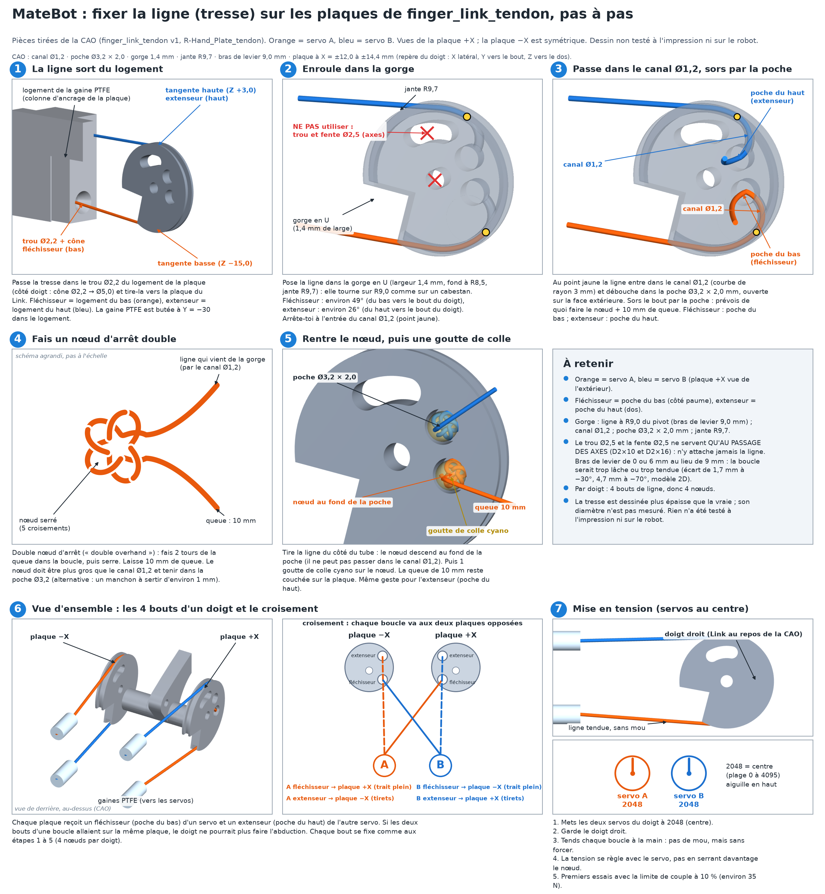

# MateBot Build Manual

Step-by-step guide to building MateBot's right forearm and tendon-driven hand.

> **Status: v0/v17, untested.** Nothing here has been checked on a finished build yet. The v17 flat forearm plate is designed (CAD verified, 22/22) but not printed. v16, v15, v14, v13, v12, v11 and v10 are superseded. Steps marked **🚧 NOT DESIGNED YET** cannot be done yet (the rotating-wrist adapter is one of them). Do not improvise them.

## Contents
0. [Overview and status](#0-overview-and-status)
1. [Tools and parts](#1-tools-and-parts)
2. [Printing](#2-printing)
3. [Servo setup (IDs and centering)](#3-servo-setup-ids-and-centering)
4. [Hand assembly](#4-hand-assembly)
5. [Tendons and PTFE tubes](#5-tendons-and-ptfe-tubes)
6. [Forearm and servo pairs](#6-forearm-and-servo-pairs)
7. [Wrist](#7-wrist)
8. [Electronics and wiring](#8-electronics-and-wiring)
9. [First test with the code](#9-first-test-with-the-code)
10. [Troubleshooting](#10-troubleshooting)

---

## 0. Overview and status

MateBot is a human-size household robot. Every part is 3D-printed, in black PETG so it can also be used outdoors.

Current scope: the **right forearm and hand**.
- **Hand:** [Amazing Hand](amazing-hand/) by Pollen Robotics, 4 fingers, 2 degrees of freedom per finger.
- **Drive:** the servos are moved out of the palm. **8 × Feetech STS3215 12 V** sit in the forearm, in **4 pairs (one pair per finger)**. The v17 chassis is **one flat plate holding a single packed row of 8** (bodies face-to-face, 0.4 mm gap, no glue): long axis across the forearm, faces TL, TR, BL, BR, repeat (thumb and middle on top, index and ring on the bottom), shafts alternating left and right. An R13 arch in both end walls (the back is no longer closed); 8 × M3 in the web (one over each servo) plus 4 × M3 per end wall (2 per side of the arc); countersunk M2 posts on index and ring.
- **Tendons:** each servo turns a double-groove spool. One groove pulls the flexor tendon, the other the extensor. Tendons run through PTFE tubes (Bowden style).
- **Motion:** both servos of a pair turning the same way = flex/extend. Opposite ways = side-to-side (abduction).
- **Forearm:** the [InMoov](inmoov/) right forearm shells, used as a temporary base.

Explainer animation: [tendon-explainer-en.mp4](matebot/docs/tendon-explainer-en.mp4).

| Part of the build | State |
|---|---|
| Finger and palm parts (Amazing Hand) | Ready to print |
| Forearm shells (InMoov) | Ready to print |
| Spools, PTFE anchor, tendon Link (`finger_link_tendon`, v1 with dowel pass-through) | v0/v1, untested |
| Servo bay (8 servos in one block) | Bench test only, does not fit in the forearm |
| Flat forearm plate (`forearm_plate`, `spool_r8`) | v17, untested (CAD 22/22). Packed single row of 8, one flat plate 56.0 × 207.6 × 20.0 mm, R13 arch in both end walls, 8 web M3 + 4 × M3 per end wall (2 per side of the arc), countersunk M2 posts. v16–v10 superseded. |
| Palm with PTFE anchor plate (`R-Hand_Plate_tendon`, `R-Palm_Shell_tendon`) | v0, untested (index, middle, ring only) |
| Wrist adapter (InMoov RotaWrist ↔ Amazing Hand Wrist_Interface) | 🚧 Not designed yet |
| Arduino Yún test code (6 servos) | Written, not tested on hardware |

---

## 1. Tools and parts

No prices are listed here. Live costs are tracked on the [MateBot build tracker](https://irlafleur.github.io/matebot-site/).

### Tools
- [ ] 3D printer (MateBot uses an Anycubic Kobra S1 and a Sovol SV06 ACE)
- [ ] Slicer (MateBot uses Anycubic Slicer Next)
- [ ] Vernier caliper (needed to measure the servos before printing MateBot parts)
- [ ] Drill bits Ø1.5 and Ø2, M2 tap, portable drill
- [ ] PH0 cross screwdriver, flat pliers, scalpel, Dremel or strong cutters
- [ ] Windows PC (for the Feetech FD software)
- [ ] Arduino Yún + micro-USB cable (test controller)

### Electronics
- [ ] 8 × Feetech STS3215 12 V serial-bus servos (+ their round horns and cables)
- [ ] 1 × Waveshare Bus Servo Adapter (A)
- [ ] 1 × 12 V power supply with barrel plug: **at least 5 A** for the 6-servo test, **10 A** recommended for all 8 servos
- [ ] Emergency stop switch on the 12 V line
- [ ] 3 jumper wires (RX, TX, GND)
- [ ] 1 × MG996R servo (wrist rotation)

### Materials and hardware
- [ ] Black PETG filament (TPU optional for finger shells)
- [ ] PE (UHMWPE) braided line, about 100 lb class
- [ ] PTFE tube 2 mm ID × 4 mm OD, about 7 m
- [ ] Crimp sleeves, about 1 mm
- [ ] M3×6 screws: 4 per spool (32), **not longer** (official 14 mm horn BCD; 4 mm in the 4.5 mm horn). The 8 centre horn screws M3×6 come with the servos.
- [ ] M2×10 flat-head screws (DIN 7991 / ISO 10642, 90°): 4 per idler-facing servo into the ears (16 on this plate, index and ring). Do not use M2×12: they would enter the case. (A second plate, if you add one later, would need another 16.)
- [ ] M2×12 (or M2×10): 6, through the yoke flange into the Wrist_Interface D2.4 holes
- [ ] M3×12 + nuts: 24 (12 rail-to-yoke laps and 12 brace holes)
- [ ] M3×8 to M3×12 button-head (ISO 7380) + nuts: 16, for the attachment holes (8 in the web, one over each servo, and 8 in the end walls, 4 per end / 2 per side of the arc; from the inside, thread out; length depends on the part you add). Fit before the servos.
- [ ] M3 screws: 4 for the bench servo bay only, 2 per PTFE anchor block if you still use that bench part
- [ ] Per finger (×4): 2 bushings Ø6 inner (**printed**, `bushing_d6_flanged.stl`, 8 + 2 spares, or only 4 + 2 spares with Option 1 below; the original is a bought igus GFM-0608-04), **no metal washer: it is printed (`bushing_washer_d6.stl`, `washer_d8_printed.stl`)**, 2 axes D2×10, 2 axes D2×16, 4 thermoplastic screws 2.5×6, 1 thermoplastic screw 2.5×8 (Option 2: **from underneath** into the post of the plate, through the printed washer; Option 1: from the top through `bushing_washer_d6`; see 4.4). The 3 screws 2.5×8 that held each Finger_Frame to the plate are no longer needed for index, middle and ring; the **thumb** still uses its 3 (it keeps its Finger_Frame-1 on the Wrist_Interface)

---

## 2. Printing

### Settings
1. Material: **PETG**, black.
2. Layer height: 0.2 mm.
3. Structural parts (forearm shells, spools, mounts): **4 to 6 walls**. Spools: 6 walls or 100 % infill.
4. Finger parts: Pollen recommends at least 80 % infill for rigid parts.
5. Remove supports carefully; clean the supported faces before assembly.

### What to print (one right hand)

**Amazing Hand** ([files](amazing-hand/))
| Part | Qty | Spares |
|---|---|---|
| Finger_Frame-1 | **1 (thumb only)**. Index, middle and ring: **0** (now part of `R-Hand_Plate_tendon`) | |
| Finger_Frame-2 | **0** (not needed in the tendon hand) | |
| Proximal | 4 | |
| Distal | 4 | +2 |
| Gimbal | **1 (thumb only)**. Index, middle and ring: **0**, print `Gimbal_tendon` instead | +1 |
| Link | **0**: print `finger_link_tendon` instead (see MateBot table) | |
| Proximal_Shell, Distal_Shell | 4 each | |
| R-Top_Shell, R-Wrist_Interface | 1 each | |
| R-Palm_Shell, R-Hand_Plate | **0**: print `R-Palm_Shell_tendon` and `R-Hand_Plate_tendon` instead (see MateBot table) | |

**MateBot** ([files](matebot/stl/))
| Part | Qty | Note |
|---|---|---|
| `spool_r8.stl` | 8 | +2 spares. Official 14 mm BCD, 4 × M3×6. Flange down, 100 % or 6 walls. |
| `forearm_plate.stl` | 1 | One flat plate (56.0 × 207.56 × 20.0 mm). Outer face on the bed, walls and posts up, no supports. |
| `ptfe_anchor_8x.stl` | 0 | Not used with the v17 plate (no PTFE sockets). Bench only. |
| `R-Hand_Plate_tendon.stl` | 1 | Replaces the R-Hand_Plate **and the Finger_Frame-1 / -2 of the 3 fingers** (pivot blocks and Gimbal posts built in). 12 PTFE sockets for 3 fingers. |
| `R-Palm_Shell_tendon.stl` | 1 | Replaces the R-Palm_Shell. Notches for the sockets and screws, bigger thumb aperture. |
| `Gimbal_tendon.stl` | 3 | +1 spare. Replaces the Gimbal of the index, middle and ring fingers (rear tab so it can be screwed from underneath). Print 1 first, tree supports under the tab. |
| `servo_bay_8x_sts3215.stl` | 1 | Bench test only |
| `bushing_d6_flanged.stl` | 8 (Option 2) or 4 (Option 1) | +2 spares. Replaces Pollen's bought D6 bushing. Option 1 only needs the lower one (4 + 2). Print upright, flange down, 0.12 mm layers, all at once. |
| `bushing_washer_d6.stl` | 4 | +2 spares. **Option 1.** Replaces the large M2.5 washer and the upper bushing (3 fingers + thumb). Print disc down, sleeve up, no supports, PETG, 0.12 mm, 100% infill. |
| `washer_d8_printed.stl` | 3 | +1 spare. **Option 2 only** (`Gimbal_tendon`, screw from underneath). Replaces the large M2.5 washer. Print flat. |
| `finger_link_tendon.stl` | 4 | +2 spares. Replaces the Link. v1: dowel holes added. Print 1 first. Needs supports. |

> The BallJoint_Rod Spacers, the original Link, Finger_Frame-2 and (except for the thumb) Finger_Frame-1 are **not needed** with the tendon drive. Proximal and Distal are printed unchanged; the Gimbal is printed unchanged only for the thumb.

> ⚠️ **Before printing MateBot parts:** measure a real STS3215 and its horn with the caliper (see [3.1](#31-measure-first)). The spool now uses the official 14 mm BCD and M3 holes from the Waveshare ST3215 drawing; still check your horn before printing a full set.

**InMoov forearm** ([files](inmoov/Right-Hand/))
| Part | Qty |
|---|---|
| `robpart2V4.stl` (lower shell) | 1 |
| `robpart5V4.stl` | 1 |
| `robpart3V4.stl` (top cover) | 1 |
| `robpart4V4.stl` | 1 |
| `robcap3V2.stl` | 1, only if you keep the InMoov elbow |

**Do NOT print:** `RobServoBedV6` or the InMoov tensioners/pulleys. The tendon drive replaces them.

**InMoov wrist:** RotaWrist1V4, RotaWrist2V3, RotaWrist3V3, WristGearsV5, CableHolderWristV5, 1 each. Not in this repo yet: get them from the [InMoov gallery](https://inmoov.fr/inmoov-stl-parts-viewer/?bodyparts=Rotation-Wrist).

### Checklist
- [ ] All finger parts ×4 + spares (incl. the bushings, `bushing_washer_d6` ×4 + 2 for Option 1 or `washer_d8_printed` ×3 + 1 for Option 2); `Gimbal_tendon` ×3 + 1 (Option 2 only); for the thumb only: 1 Finger_Frame-1 and 1 stock Gimbal
- [ ] Palm parts ×1
- [ ] 10 spools
- [ ] v17 plate: 1 × `forearm_plate` (flat, one piece)
- [ ] Forearm shells (optional temporary cover; fit around the v17 pack is not checked)
- [ ] Wrist parts (RotaWrist adapter still not designed; the v17 plate has no wrist flange)

---

## 3. Servo setup (IDs and centering)

Do this **before** any assembly. Every STS3215 ships with ID 1, so they cannot share a bus until each has its own ID.

### 3.1 Measure first
1. Measure one servo body with the caliper. Official drawing (Waveshare ST3215-2D.zip, PDF titled SCS215, 8 June 2022, and ST3215-3D.zip): body **45.22 × 24.72 mm**, 35 mm to the output-horn outer face. Feetech's product page rounds this to 45.2 × 24.7 × 35 mm.
2. Measure the round horn: official bolt circle **14 mm**, four M3 holes (Ø2.5, 2.5 mm deep from the outer face), horn 4.5 mm thick.
3. Measure the mounting ears. Mount through the **idler** ears only (pattern 24.45 × 20.50 mm, case holes Ø1.6). The output-side pattern is different. Use M2×10 flat-head (DIN 7991) only.
4. Compare with `matebot/source/sts3215.py`. Pocket clearance `CL = 0.4 mm` is a print allowance, not a drawing dimension. Do not print a full set until the first servo fits.

### 3.2 Choose an ID scheme
Pick one and stick to it:
- **1 to 8** (Amazing Hand guide): index 1-2, middle 3-4, ring 5-6, thumb 7-8.
- **21 to 28** (reserves 1-20 for the rest of the robot).
The 6-servo test sketch uses IDs 1 to 6.

### 3.3 Set the IDs with Feetech FD
1. Download FD from the [Feetech software page](https://www.feetechrc.com/software.html) (direct link: [FD 1.9.8.3](https://www.feetechrc.com/Data/feetechrc/upload/file/20240622/FD1.9.8.3.zip)). Unzip and run `FD.exe`. If no COM port appears, install the WCH CH343 driver.
2. Put the Waveshare adapter jumper on **B** (USB mode).
3. Plug the adapter into the PC by USB-C and plug 12 V into its barrel jack.
4. Connect **one servo only**.
5. In FD: pick the COM port, baud **1000000**, click **Open**.
6. Click **Search**. When the servo appears (ID 1), click **Stop** and select it.
7. Open the **Programming** tab. Select the **ID** row (address 5).
8. Type the new ID, click **Save**.
9. Power-cycle the servo. Search again to confirm the new ID.
10. **Label the servo** with its ID (tape + marker).
11. Repeat for every servo.

### 3.4 Center each servo
1. With the servo alone on the bus, move it to the middle position (2048 out of 0-4095 on the STS3215).
2. If your horn is not aligned at center, use FD's calibration / middle-position function, or see the [ArmDojo guide](https://armdojo.com/blogs/guides/how-to-set-feetech-sts3215-servo-ids-zero-offsets-waveshare).
3. Check it turns smoothly and quietly.
4. Set a **low torque limit (10 % for the first finger tests, 30 % at most later)** in the EEPROM before the first loaded test.

- [ ] All servos measured, labelled, centered, and answering alone on the bus

---

## 4. Hand assembly

Based on Pollen's official guide ([AmazingHand docs](https://github.com/pollen-robotics/AmazingHand/tree/main/docs)). Repeat for each of the 4 fingers.

### 4.1 Prepare the parts
1. Ream the Ø2 pivot holes in Proximal, Distal, Gimbal and `finger_link_tendon` (it has the same pivot holes as the Link) with the Ø2 drill:
   - **sliding** holes: several passes;
   - **tight** holes: one pass only.
2. Clean faces that had supports.

### 4.2 Finger mechanism
1. Place the `finger_link_tendon` (in the place of the Link) between the Distal's ears and push in an axis D2×10. The two plates must point outward, one on each side.
2. Do the same with the Gimbal: the D2×10 pin goes through the **round Ø2.5 hole in the middle of the plate** (the Link pivot), through the Gimbal and the Link, and stops flush with the Gimbal (X = ±5). Push it from either side.
3. Push the D2×16 axes into the Proximal to hold the sub-assembly. The Gimbal ↔ Proximal pin goes through the **Ø2.5 arc slot above the pivot** in the plate: turn the Link slightly (extension to a little flexion, about +10° to −30°) until the slot lines up with the pin, then push. Once the pins are in, the holes and slot are free and not used.
4. **Check:** flexion and extension are smooth over the full travel.

### 4.3 Shells
1. Fit the Proximal_Shell, then the Distal_Shell, with 2.5×6 screws.
2. **Do not over-tighten**: the screw can go through the thin shell.

### 4.4 Bushings and final finger
1. Press the first printed `bushing_d6_flanged` into the **lower** end of the pivot bore of the plate (`R-Hand_Plate_tendon`, Ø8.15, replaces Finger_Frame-1), flange outside, against a flat surface until the flange touches the block. If a bushing is loose, add a drop of CA glue on its body; if the Gimbal boss does not turn freely, pass a Ø6.2 drill through the bore by hand and add a drop of PTFE or silicone grease.
2. Offer the finger (its `Gimbal_tendon`, boss up) from below: the boss goes up through that bushing and the **post of the plate goes through the arc slot of the tab**.
3. Press the second bushing into the upper end of the bore from above (flange in the slab notch).
*Drawings: `matebot/docs/assemblage_doigt_eclate_FR.png` and `assemblage_coupes_vis_FR.png`. **Option 1, without `Gimbal_tendon` (v8, no metal washer):** stock Gimbal, only the lower bushing in step 1 (skip step 3). Drop the printed `bushing_washer_d6` over the boss from above (sleeve down into the bore, disc on the end of the boss), then Pollen's 2.5×8 screw through its Ø2.7 hole into the Gimbal's end hole (Ø1.9, blind, 7.1 mm of thread). Tighten until the disc is clamped on the boss end: it then turns with the Gimbal, which must stay free in yaw. R-Top_Shell must be off to tighten it. See `matebot/README.md`, section "The bushing-washer".*
4. **Screw the Gimbal from underneath (Option 2):** printed `washer_d8_printed` (no metal washer), then the **2.5×8 thermoplastic screw** into the post's Ø1.9 pilot hole (from below, 7.1 mm of thread in the post). Tighten until the head sits on the post: the washer then stays 0.4 mm below the tab and does not clamp it. **Abduction (±25°) must stay free.** (The thumb keeps the original: stock Gimbal, 2.5×8 screw on top of the boss, with the printed `bushing_washer_d6` instead of the washer.)

### 4.5 Palm
1. Use `R-Hand_Plate_tendon` instead of the original R-Hand_Plate, and `R-Palm_Shell_tendon` instead of the R-Palm_Shell (untested). **Fit the palm shell last**, after every Gimbal screw is in (the screw heads are underneath).
2. The plate takes **3 fingers**: index on the left, middle in the middle, ring on the right (top view), as in Pollen's guide "Step 4: Hand assembly". There are **no Finger_Frames** for these 3 fingers any more: each finger is held by its Gimbal screw (4.4), nothing else to fix.
3. The **thumb** goes on the Wrist_Interface as in Pollen's guide, with its own Finger_Frame-1 and stock Gimbal (printed, 1 each) and its own 2 bushings. The palm shell has a bigger thumb aperture; **check by hand that the thumb moves through its whole range without touching the shell** (the aperture was designed with an estimated thumb position). Its 4 tube ends are not on the v17 plate (no sockets; tubes pass around for now). The rotating-wrist adapter (RotaWrist ↔ Wrist_Interface) is still 🚧 not designed; the yoke holds a fixed wrist.
4. Each finger side has an anchor column under the plate with 2 sockets: **extensor on top, flexor below**. Cut the PTFE tubes square and push each one in until it stops (8 mm), then add a drop of CA glue.
5. Pass the tendon through the tube and through the cone-shaped exit toward the finger, then to the Link plate (see 4.6).

### 4.6 Tendon attachment on the finger
*Step-by-step drawing with French labels (socket, groove, channel, pocket, double stopper knot, crossing of the 4 line ends, tensioning at servo position 2048): [`matebot/docs/noeud_tendon_etapes_FR.png`](matebot/docs/noeud_tendon_etapes_FR.png).*

1. The ball-joint rods are not used. The tendons attach to the two plates of `finger_link_tendon` (v0, untested).
2. Each plate has a groove on its rim and two pockets. **Lower pocket = flexor** (palm side), **upper pocket = extensor** (back of the finger).
3. **Cross the loops.** Servo A: flexor on the +X plate, extensor on the −X plate. Servo B: flexor on the −X plate, extensor on the +X plate. Do not put both legs of one servo on the same plate: the finger could not abduct.
4. For each leg: pass the tendon through the Ø1.2 channel from the groove into the pocket, tie a **double overhand (stopper) knot** (or crimp a sleeve) in the pocket, leave a 10 mm tail, pull the tendon back so the knot seats at the bottom of the pocket, then add one drop of CA glue. The knot or sleeve must be bigger than the 1.2 mm channel. **Do not tie the tendon in the Ø2.5 dowel hole or slot**: their lever arm (6 mm or 0 mm) does not match the 9 mm groove, so the loop would not stay closed.
5. Lay the tendon in the groove and run it straight back toward the palm: the flexor leaves the bottom of the plate, the extensor the top.
6. The tube ends are in the sockets of `R-Hand_Plate_tendon`, 30 mm behind the finger base. The flexor tube is the lower socket (palm side), the extensor tube the upper socket (back). The tendon leans about 6° inward from the socket to the Link plate. Do not cross tubes between fingers.
7. Check that the plates (up to X = ±14.4 mm) do not touch the next finger or the palm window, over the full flexion and abduction range.

---

## 5. Tendons and PTFE tubes

### 5.1 Spools
1. Fix the spool on the servo's round horn with **4 × M3×6** (official 14 mm BCD). Do not use a longer screw: 4 mm go into the 4.5 mm horn, 0.5 mm short of the inner face (Waveshare: a screw that bottoms on the housing can burn the servo). The centre hole lets the horn's M3×6 centre screw through.
2. Put the servo at **center**.
3. Thread the flexor tendon through the cross hole of one groove, the extensor through the other.
4. Wrap **at least 1.5 turns** in each groove, in **opposite directions**: when the spool turns, one tendon is pulled and the other is released by the same length.
5. Reference (CAD estimate, Link v1 with 9.0 mm lever arm): full flexion (about 70° of Link rotation) ≈ 11 mm of tendon; abduction ±20° ≈ ±4.5 mm. Up to about 15.5 mm in total ≈ 111° of spool rotation.
6. **First tests at a servo torque limit of 10 %** (about 35 N of tendon tension): the Link is the weakest part.

### 5.2 PTFE tubes
1. Cut 16 tubes (8 loops × 2), about 30 to 40 cm each. Exact length depends on the station (thumb shortest, ring longest).
2. Fix the **palm ends** of every tube in the sockets of `R-Hand_Plate_tendon` (12 sockets for index, middle and ring). The v17 plate has no servo-side sockets; run the PTFE around the plate for now and fix the servo-side ends later. The thumb's 4 palm-side ends still go on to the thumb on the Wrist_Interface. Measure your PTFE tube with calipers first: the palm sockets assume a 4.0 mm OD. Keep a bend radius of at least 30 mm so the bundles do not cross in 3D.
3. Keep a **bend radius of at least 30 mm** everywhere.
4. Route the bundle **through the center of the wrist**.
5. Label every tube: finger, A or B, flexor or extensor (colored tape).

### 5.3 Tension
1. Put both servos of the finger at center.
2. Hold the finger straight and pull each loop snug by hand.
3. Knot or crimp it.
4. No slack, but don't force it: fine tension comes from the servo.
5. After 30 min of cycling, check for line creep and re-tension.

---

## 6. Forearm and servo pairs

### 6.1 Forearm shells
1. The v17 chassis is a **simple printed flat plate**, not a shell. The arm will be redesigned later. The InMoov right-forearm shells can still be printed as a temporary cover, but **fitting the 207.6 × 56 mm plate plus the hanging servos inside those shells has not been checked**.
2. If you print the InMoov shells anyway: glue robpart2V4 to robpart5V4 (lower shell) and robpart3V4 to robpart4V4 (top cover).

### 6.2 The flat plate (v17, untested)
Previews: [chassis](matebot/docs/forearm_chassis_preview.png), [parts](matebot/docs/forearm_parts_preview.png), [holes, screws and cables (FR)](matebot/docs/forearm_tubes_FR.png). v16, v15, v14, v13, v12, v11 and v10 are superseded.

**Layout.** One row of 8 STS3215, long axis across the forearm, shaft perpendicular to the plate. Sequence front to back: TL, TR, BL, BR, repeat (thumb top, index bottom, middle top, ring bottom). Shafts alternate left and right. Bodies sit face-to-face with a 0.4 mm nominal gap (no glue). One flat 4 mm plate, **56 mm** wide. Both end walls have one R13 semicircular arch, open at the free edge (26 mm opening, 3 mm lintel); the two Ø10 cable holes are gone and the back is no longer closed. 8 × M3 in the web (one over each servo, opposite the cut-out, counterbored inside) plus 4 × M3 in each end wall (two on each side of the arc, x = ±24 mm, z = −5.0 and −12.5 mm), screws from the inside to the outside; 16 × M2×10 flat-head (countersunk) in 3.5 mm-wall posts for index and ring. Wall height stays 16 mm: the stacked holes sit beside the arc, so the walls did not need to be raised.

**Dimensions.** 56.0 × 207.56 × 20.0 mm (packed bodies 200.56 mm + two 3.5 mm walls). Under 250 mm.

**Assembly (all untested):**
1. Lay the 8 servos in order, long axis across, idler ears of **index and ring** against the plate, spools of **thumb and middle** through the Ø28 cut-outs.
2. Fix index and ring with 4 × M2×10 flat-head (DIN 7991 / ISO 10642) each, from the **outside** of the plate, through the countersunk posts, into the idler ears. Do not use M2×12. Thumb and middle are not screwed to this plate (their idler ears are on the far side); they are held by the packed neighbours and the back wall. If they need a clamped mount later, add a second identical flat plate on the other face.
3. Fit each `spool_r8` on the output horn (it passes through the Ø28 cut-out on thumb and middle) with 4 × M3×6, then the centre M3×6 horn screw.
4. Daisy-chain the bus cables: they leave the bodies at the sides, then can be dressed through the R13 arch in the front wall (and the matching arch at the back), to the Waveshare adapter.
5. Later attachments bolt on with M3 through the 8 web holes (one over each servo, opposite the cut-out) and through the 4 holes in each end wall (two on each side of the arc, from the inside toward the outside). Use an ISO 7380 button head so it sits flush in the inner-face counterbore and does not hit a servo. Fit these screws before the servos.
6. For bench tests without the plate, `servo_bay_8x_sts3215.stl` is still available. It does **not** fit inside the forearm.

---

## 7. Wrist

1. Print the InMoov rotating wrist: RotaWrist1V4, RotaWrist2V3, RotaWrist3V3, WristGearsV5, CableHolderWristV5.
2. Assemble it with one **MG996R** servo following the InMoov instructions on [inmoov.fr](https://inmoov.fr/hand-and-forarm/).
3. 🚧 **NOT DESIGNED YET:** adapter between the RotaWrist and the Amazing Hand `R-Wrist_Interface`. The Wrist_Interface does not bolt onto the RotaWrist as is.
4. ⚠️ The PTFE tubes may not pass through the InMoov wrist. To be checked once printed.
5. The MG996R is a PWM servo: it is **not** on the Feetech bus and needs its own driver (🚧 not covered yet).

---

## 8. Electronics and wiring

> Never connect 12 V to the Arduino Yún.

### 8.1 Adapter modes
| Jumper | Use |
|---|---|
| **B** | USB to PC, for FD (setting IDs) |
| **A** | UART to a microcontroller (Yún) |

### 8.2 Wiring to the Yún (jumper on A)
1. Adapter **RX → Yún pin 0 (RX)**.
2. Adapter **TX → Yún pin 1 (TX)**. (RX-RX / TX-TX is what Waveshare specifies for this board.)
3. Adapter **GND → Yún GND** (common ground required).
4. **12 V only into the adapter's barrel jack**, through the emergency stop.
5. Adapter USB-C stays **unplugged**. The Yún is powered by its own micro-USB.
6. Chain the servos: adapter → servo 1 → servo 2 → … → servo 6.

### 8.3 Free the Yún serial port
Pins 0/1 are also used by the Yún's Linux side as a console.
1. SSH into the Yún.
2. Edit `/etc/inittab` and comment out (`#`) the line with `ttyATH0`.
3. `reboot`.

- [ ] Jumper on A
- [ ] RX-RX, TX-TX, GND-GND
- [ ] 12 V on adapter only, e-stop within reach
- [ ] ttyATH0 disabled

---

## 9. First test with the code

Code and details: [matebot/code/yun-6-servos](matebot/code/yun-6-servos/).

1. Install **Arduino IDE 2**. Board: "Arduino Yún" (in Arduino AVR Boards, nothing to add).
2. Open `yun_6_servos/yun_6_servos.ino`, select the port, upload.
3. Open the Serial Monitor: **115200 baud**, line ending **Newline**.
4. **No tendons attached** for the first run.
5. Type `scan`: each servo should answer with its position.
6. Type `m 1 2200`: servo 1 moves a little. Try each ID.
7. Type `sweep`: all move, then return to center (2048).
8. `off` / `on` turns torque off / on. `r 3` reads servo 3.

### First finger test (one finger, two servos, 40 cm tubes)
1. Torque limit 10 % (30 % at most once the finger is proven).
2. Small moves around center: A+B same way = flex/extend, opposite = abduction.
3. Note travel, backlash, friction (servo load reading) and temperature.
4. Next: fingertip force with a spring scale, all 4 fingers, grip a water bottle, 30 min endurance. Report the numbers so this manual can be updated.

---

## 10. Troubleshooting

| Problem | Check |
|---|---|
| FD finds no COM port | Install the CH343 driver; try another USB cable (data, not charge-only) |
| FD finds no servo | Jumper on B? 12 V plugged in? Baud 1000000? Only one servo connected? |
| Two servos answer as one / garbage | Duplicate IDs: set IDs one servo at a time |
| `scan` on the Yún gets no answer | Jumper on A? GND shared? RX/TX swapped? ttyATH0 disabled? Wait ~1 min after boot |
| Servo jitters or resets under load | Supply too weak (use ≥5 A, 10 A for 8 servos); check 12 V wires |
| Servo gets hot | Lower torque limit; never hold it stalled; check tendons are not over-tight |
| Finger does not flex fully | Slack in the loop, too much tube friction (bend radius < 30 mm), spool slipping |
| Abduction stuck | 2.5×8 screw too tight in the Gimbal |
| Spool doesn't fit the horn | Pattern is the official 14 mm BCD / M3 from the Waveshare drawing: measure your horn and compare with `sts3215.py` |
| Servo too tight in its pocket | Clearance is 0.4 mm per side on the v17 plate: sand lightly or reprint with more clearance |

### Safety
- Emergency stop on the 12 V line, within reach.
- Start with a 10 % torque limit (the tendon Link is the weak part); watch temperature.
- Keep fingers and hair away from spools. Wear glasses: a tendon can snap under tension.

---

## TODO (coming soon)
- [ ] Caliper measurements of a real STS3215 and horn, compared with `sts3215.py`; first-article fit of one pocket and one spool
- [ ] Print and test the v17 flat plate (designed, CAD 22/22, not printed)
- [ ] Print and test `R-Hand_Plate_tendon` and `R-Palm_Shell_tendon` (v1 designed, not printed)
- [ ] RotaWrist ↔ Wrist_Interface adapter; PTFE routing through a *rotating* wrist (the v17 plate has no wrist flange and no PTFE sockets)
- [ ] MG996R wrist driver
- [ ] Final ID scheme (1-8 or 21-28)
- [ ] 8-servo code and hardware test results

*Based on the Amazing Hand by Pollen Robotics (CC BY 4.0) and InMoov by Gael Langevin (CC BY-NC). See each folder's license.*
