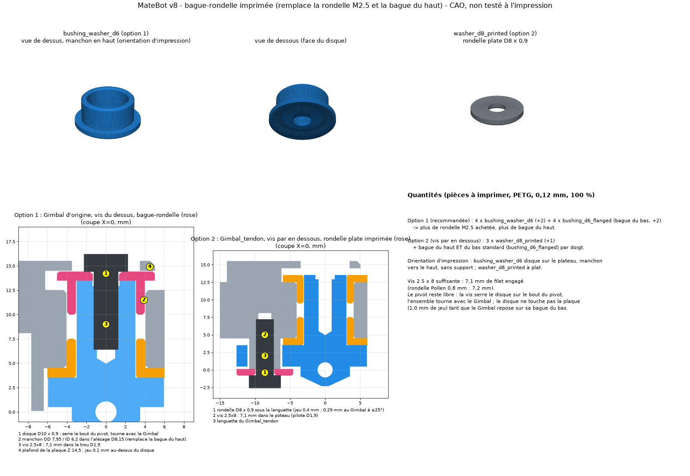
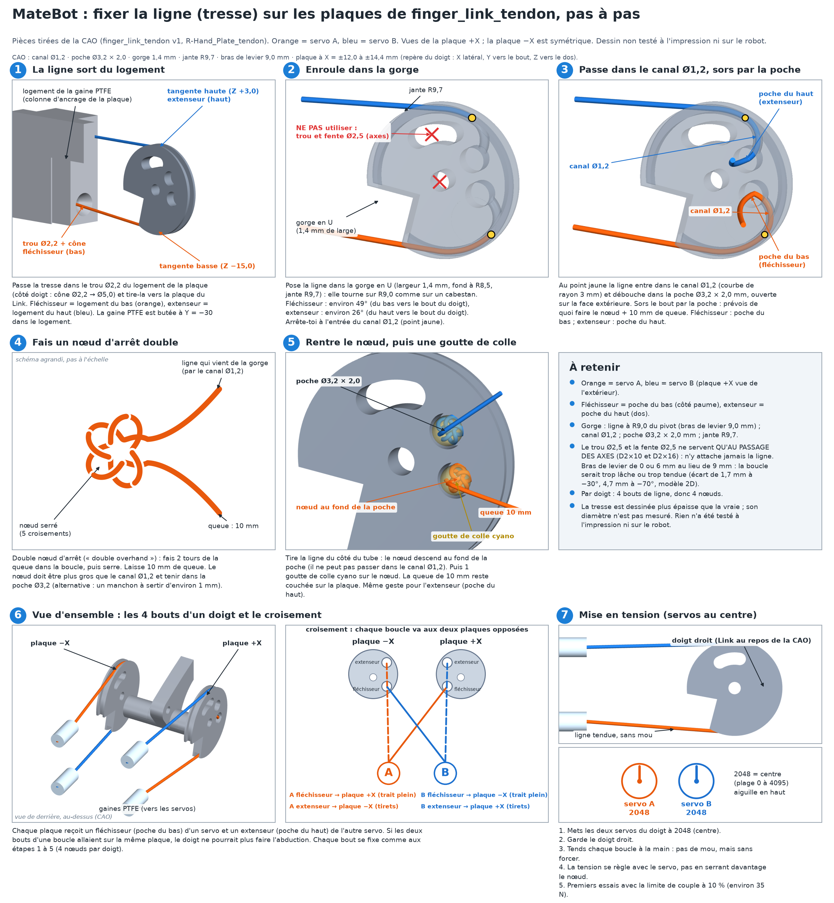

# MateBot parts (tendon-driven hand)

MateBot moves the Amazing Hand's 8 servos out of the palm and into the forearm. Each finger is driven by a pair of Feetech STS3215 (12 V) servos pulling tendons through PTFE tubes.

**Status: v0/v1/v15, untested.** v14 (and v13, v12, v11, v10) of the forearm chassis is superseded. Nothing here has been validated on a real build. Measure your own servo and servo horn before printing.

## Folders

- `stl/`: ready-to-print files
- `step/`: editable CAD files
- `source/`: Python (CadQuery) scripts that generate the parts: `parts.py` (spool, PTFE anchor, servo bay), `sts3215.py` (official STS3215 envelope from the Waveshare 2D/STEP drawings), `forearm_mount_row.py` (v15 one-piece 56 mm flat plate with 8 web M3 attachments and countersunk M2 posts, packed single row of 8, with `verify_forearm_mount_row.py` and `render_forearm_mount_row.py`; v14–v10 plates are superseded), `finger_link_tendon.py` (the modified finger Link), `bushing_d6.py` (the printable finger bushing, with `verify_bushing_d6.py` and `render_bushing_d6.py`), `bushing_washer_d6.py` (the printed bushing + washer for the screw, v8, with `verify_bushing_washer_d6.py` and `render_bushing_washer_d6.py`) and `R-Hand_Plate_tendon.py` (the modified hand plate and palm shell, now with the Gimbal pivot blocks), `Gimbal_tendon.py` (the Gimbal with a retention tab), with `verify_R-Hand_Plate_tendon.py`, `render_plate_tendon.py` and `render_gimbal_thumb.py`, `render_assembly_fr.py` (the French assembly drawings)
- `docs/`: design notes, assembly guide (French), preview images (`finger_link_tendon_preview.png`, `finger_link_tendon_routing.png`, `R-Hand_Plate_tendon_preview.png`, `R-Hand_Plate_tendon_routing.png`, `Gimbal_tendon_preview.png`, `thumb_aperture_preview.png`, `assemblage_doigt_eclate_FR.png`, `assemblage_coupes_vis_FR.png`, `bushing_d6_preview.png`, `bushing_washer_d6_preview.png`, `forearm_chassis_preview.png`, `forearm_parts_preview.png`, `forearm_tubes_FR.png`, `spool_r8_preview.png`) and an explainer animation

## Parts to print

| File | Quantity | Notes |
|---|---|---|
| `spool_r8.stl` | 8 (+2 spare) | One per servo. Two grooves: flexor and extensor. Official 14 mm horn BCD, 4 × M3×6 (not longer). 100% infill or 6 walls. See [the forearm chassis](#the-flat-forearm-plate-v15-untested). |
| `forearm_plate.stl` | 1 | **New in v15.** One flat plate (56.0 × 207.6 × 20.0 mm). Packed row of 8, 8 × M3 over the bodies, countersunk M2 posts. |
| `forearm_plate_top.stl` / `forearm_plate_bottom.stl` | 0 | **Superseded (v12).** Two U-plates. Do not print these for a new build. |
| `forearm_plate_top_wrist.stl` / `_elbow` / `forearm_plate_bottom_wrist.stl` / `_elbow` | 0 | **Superseded (v11).** Split halves. Do not print these for a new build. |
| `forearm_wrist_yoke.stl` / `forearm_rail_3x_L.stl` / `_R` / `forearm_brace.stl` | 0 | **Superseded (v10).** Do not print these for a new build. |
| `ptfe_anchor_8x.stl` | 0 (bench only) | **Not used with the v15 plate.** No PTFE sockets on this plate; tubes pass around. Bench only. |
| `servo_bay_8x_sts3215.stl` | 1 | **Bench testing only.** It does not fit inside the forearm; the v15 plate is the current arm mount (minimal, not yet a full forearm). |
| `finger_link_tendon.stl` | 4 (+2 spares) | **Replaces Pollen's `Link`** (do not also print the original Link). Same pivot holes, plus a cross bar and two tendon plates, now with **dowel pass-through holes** (v1). Print 1 first. Needs supports. |
| `Gimbal_tendon.stl` | 3 (+1 spare) | **Replaces Pollen's `Gimbal` on the index, middle and ring fingers** (do not also print the original Gimbal for those 3). Identical, plus a rear tab with an arc slot so the Gimbal can be **screwed from underneath the plate** (see [the Gimbal section](#the-gimbal-screwed-from-underneath-gimbal_tendon-v0-untested)). |
| `bushing_washer_d6.stl` | 4 (+2 spares) | **New in v8. Replaces the large M2.5 washer AND the upper bushing** on the stock-Gimbal option (the screw from the top): one printed top-hat part, disc Ø10 × 0.9 + sleeve OD 7.95 / ID 6.2 × 3.5. Used for the 3 fingers and the thumb. Print disc down, sleeve up, no supports. See [the section below](#the-bushing-washer-bushing_washer_d6-v8-untested). |
| `washer_d8_printed.stl` | 3 (+1 spare) | **New in v8. Replaces the large M2.5 washer of the `Gimbal_tendon` option only** (screw from underneath): flat washer Ø8 × 0.9, hole Ø2.7. Print flat. Not needed with the stock-Gimbal option. |
| `bushing_d6_flanged.stl` | Option 1 (stock Gimbal): 4 (+2 spares), the lower bushing only. Option 2 (`Gimbal_tendon`): 8 (+2 spares) | **Printable version of Pollen's "Bushing D interior 6 mm"** (GFM-0608-04), pressed into the pivot bores of `R-Hand_Plate_tendon`. Small part: print them all at once. With the top-hat part of Option 1, the upper bushing is no longer used. See [the bushing section](#the-finger-bushing-bushing_d6_flanged-v0-untested). |
| `R-Hand_Plate_tendon.stl` | 1 | **Replaces Pollen's `R-Hand_Plate` and, for the 3 fingers, Finger_Frame-1 and Finger_Frame-2.** Same outline and screw holes, plus a Gimbal pivot block with the D8.15 bore under each finger window, a Gimbal retention post, and 12 PTFE tube sockets. Needs no support (same as the original). |
| `R-Palm_Shell_tendon.stl` | 1 | **Replaces Pollen's `R-Palm_Shell`.** Same shell with notches where the new sockets, posts and screw heads reach it, and a **bigger thumb aperture**. Print in the same material as the original. |

**No longer printed for the index, middle and ring fingers: `Finger_Frame-1` and `Finger_Frame-2`.** Frame-1's function (the D8.15 Gimbal bore with its bushings) is now part of `R-Hand_Plate_tendon`; Frame-2 only carried the servos of the original hand and has no job in the tendon hand. **The thumb is the exception:** it is not on the plate but on the Wrist_Interface, so it still needs **1 printed `Finger_Frame-1`** (Pollen's file, unchanged) and **1 stock `Gimbal`**, plus its own 2 bushings (already in the 10). Print the thumb's Proximal, Distal, shells and `finger_link_tendon` as for the other fingers (4 each).

## The finger bushing: `bushing_d6_flanged` (v0, untested)

**What Pollen calls it.** In the Amazing Hand bill of materials and assembly guide (Step 2, "Bushings") it is **"Bushing D interior 6 mm / D exterior 8 mm", part number GFM-0608-04**: an igus iglidur GFM flanged plastic bush, 6 mm bore, 8 mm OD, 4 mm long including the flange, flange D12 × 1 mm. It is a *bought* part, 2 per finger (8 per hand with the thumb), so it was never in the STL set. It is the only bushing in the hand: the D2×10 and D2×16 axes turn directly in the printed holes of the Gimbal, Proximal, Distal and Link, and the BallJoint_Rod Spacers (not needed with tendons) are not bushings.

**Where it goes.** The finger's abduction / adduction pivot. The Gimbal has a D6.0 boss (Z 3.5 to 13.5 in the finger frame); the plate's pivot block (`R-Hand_Plate_tendon`, which replaces Finger_Frame-1) has the same D8.15 through bore (8.0 mm long, Z 4.5 to 12.5). One bushing is pushed in from each side, flange outside, until the flange touches the frame. The boss sticks out of the frame by exactly 1.0 mm on each side, which is the flange thickness, so the M2.5 large washer and the 2.5×8 screw end up resting on the outer flange.

| | Printed `bushing_d6_flanged` | Pollen / igus GFM-0608-04 |
|---|---|---|
| Bore | **D6.20** (the Gimbal boss is D6.0) | D6.0 (+0.02 to +0.07) |
| Body OD | **D8.10** (frame bore D8.15 in the CAD) | D8.0 |
| Flange | D12.0 × 1.0 | D12 × 1 |
| Total length | 4.0 (body 3.0 under the flange) | 4.0 |
| Wall | 0.95 mm (body), 1.0 mm (flange) | |
| Chamfers | 0.25 on the outer body tip (lead-in), 0.2 on the bore both ends | 0.5 |
| Quantity | **8 (+2 spares = 10)** | 8 |

- **Print:** upright (flange on the bed, body up, no support), PETG, 0.12 mm layers, 3 or more walls (the 0.95 mm wall is all perimeters), 100% infill, about 40 mm/s. Put all 10 on one plate with 3 mm spacing.
- **Fit:** the printed plate bore usually comes out slightly under the drawn D8.15, so the body is a light press fit. Push the bushing in against a flat surface. If it will not go, sand the body; if it is loose, a drop of CA glue on the body. Pass a D6.2 drill or reamer by hand through the bore if the Gimbal boss does not turn freely (D6.3 if it is still tight). One drop of PTFE or silicone grease on the boss; PETG running on PETG can squeak.
- **Measure before printing all 10:** the real bore of your printed plate and the real boss of your printed Gimbal (caliper). Print 2 test bushings first. To re-size, edit `od` and `bore` in `source/bushing_d6.py` and run it.
- **Verified in CAD** (`source/verify_bushing_d6.py`, 12 of 12 pass): the pair fits the stock Frame-1 bore (identical to the plate bore) and the Gimbal boss with no interference, with the Gimbal turned ±30°; no contact with Finger_Frame-2, Proximal, shells, Distal, the hand plate, `finger_link_tendon`, `R-Hand_Plate_tendon` or `R-Palm_Shell_tendon` (they sit at |X| ≥ 12 mm, far from the D12 flanges), and none while Proximal, shells, Distal and Link are swept through −80° to 0° of flexion. The flange only touches the Proximal if the finger is pushed more than +5° past straight; the frame itself stops the Proximal at +7°.
- **Not verified:** real printed tolerances, wear and friction of PETG on PETG, and the thumb (its Finger_Frame-1 is the original Pollen file; the bushings were checked on the fingers' bore, which is the same D8.15). v1 adds: the pair fits the new plate bore of all 3 fingers, and the upper flange sits in the slab notch (0 mm³ interference, `verify_R-Hand_Plate_tendon.py`).
- Original part, if you ever prefer to buy it: igus iglidur GFM-0608-04 (Pollen's BOM lists 8 per hand at about 1.60 EUR each). Nothing was bought.

## The palm plate: `R-Hand_Plate_tendon` (v1, untested)

Pollen's plate holds 3 fingers (index, middle, ring) in 3 windows. The **thumb is not on this plate**: it screws into the Wrist_Interface. So the plate takes 3 fingers × 4 tendons = **12 tube ends** (not 8). The thumb's 4 tube ends are not on the v15 plate (no sockets; tubes pass around for now). The rotating-wrist adapter (InMoov RotaWrist ↔ Wrist_Interface) is still not designed; the v10 yoke bolts to the Wrist_Interface with a **fixed wrist**.

**v1 changes (all three fingers):**

1. **Finger_Frame-1 and Finger_Frame-2 are no longer printed.** Under each finger window the plate now has a **Gimbal pivot block**: the exact outline of Frame-1's bottom face (X ±10, Y −15 to +6) from the slab underside down to Z = 4.5, i.e. the 8 mm long block of Frame-1, with the same **Ø8.15 through bore** (0.3 mm lead-in chamfer on both ends) for the 2 bushings and the Gimbal boss. The Gimbal therefore mounts directly on the plate. The original M2 screw holes stay; Frame-2 only carried the servos and is not needed.
2. **The Gimbal is screwed from underneath** (see [the Gimbal section](#the-gimbal-screwed-from-underneath-gimbal_tendon-v0-untested)): a **Ø4.4 post** hangs under each block at X = 0, Y = −8.6 (finger frame), down to Z = 0.1, with a **Ø1.9 pilot hole 8 mm deep** opening at its bottom face.
3. **Anchor columns 1.5 mm shorter, sockets 1.5 mm closer.**
4. The palm shell (`R-Palm_Shell_tendon`) has a bigger thumb aperture.

Each finger side gets one **anchor column** that hangs under the plate and holds two sockets, the extensor above the flexor (6 columns, 12 sockets):

| Item | Value (finger frame: X sideways, Y along the finger, Z toward the back of the hand) |
|---|---|
| Tube socket | Ø4.2 mm bore, 8.0 mm deep, for 4 mm OD PTFE tube |
| Stop shoulder | 1.6 mm thick, Ø2.2 mm through-hole for the tendon |
| Tendon exit | cone from Ø2.2 to Ø5.0 mm over 3.0 mm, facing the finger (lets the tendon swing without rubbing) |
| Tube end (stop face) | Y = −30.0 mm, i.e. 30 mm behind the finger pivot |
| Socket axes | X = ±10.5 mm, extensor at Z = +2.3 mm, **flexor at Z = −12.8 mm (v0: −14.3)**: the two sockets are **15.1 mm apart (v0 16.6)**. The tendons leave the 9.0 mm capstan tangents at Z = +3.0 and −15.0, so the extensor leans 0.7 mm and the **flexor 2.2 mm** over the 25 mm to the socket (Link pivot at Z = −6); the tendon corridors (Ø3.0) are re-aimed at the real tangent points |
| Column | 8.2 mm wide, 12.6 mm long (Y −38.0 to −25.4), from the slab top (Z = 15.5) down to **Z = −16.9 mm: 32.4 mm tall (v0: 33.9)** |
| Wall around every socket | 2.0 mm (bore, also under the flexor bore), 1.6 mm (cone mouth) |

The 1.5 mm came entirely out of the flexor side (flexor moved up, extensor and column top unchanged): moving both sockets 0.75 mm each would have left only 1.25 mm of wall under the flexor bore, below the 1.6 mm minimum.

The sockets sit at X = ±10.5, not at the capstan lines X = ±13.2: this keeps the sockets of neighbouring fingers at least 7.9 mm apart (the fingers fan out by 5.8° and 13.5°), and the tendon leans about 6° inward between the socket and the capstan.

Other changes to the original plate: a Ø4.5 mm clearance hole behind each extensor socket where the tube crosses the plate's cross beam (the flexor tubes pass under the plate), a Ø3 mm tendon corridor, and a cylindrical relief (R10.3) around each Link capstan plate, **v1: 2.6 mm wider on the outer side of each plate** so the Link plates can abduct ±25° without touching the plate rails (the ring finger's plate touched by 1.5 mm³ at +25°). All original screw holes are kept.

**Palm shell (`R-Palm_Shell_tendon`).** Notches where the columns (grown by 0.6 mm), the Gimbal post, washer and screw head reach the shell, and a **bigger thumb aperture**: the shell loses about 1030 mm³ in total (v0: 764 mm³), most of it the thumb aperture. The aperture is the envelope of the thumb's parts swept through the full range (abduction ±25°, flexion −80° to +5°) plus **1.5 mm of clearance all round**: the tendon Link's capstan plates (the part that collided with the stock hole) and the Proximal / Proximal_Shell at the wrist end of the aperture (the stock shell edge is only 0.9 mm from the Proximal_Shell at +25° abduction). See `docs/thumb_aperture_preview.png`. **The thumb's position and angle are ESTIMATED**: they come from the 3-hole screw pattern of the Wrist_Interface (the hand's thumb mount), not from Pollen's assembly file.

What was **checked in CAD** (script `source/verify_R-Hand_Plate_tendon.py`, 34 checks, see the numbers in the output): single valid solid; finger positions fitted to the plate's own screw holes (worst error 0.19 mm); no original hole plugged; wall ≥ 1.6 mm around all 12 sockets; Ø8.15 bores coaxial with the finger axes; the 2 bushings fit each bore and the slab notch; stock Gimbal and `Gimbal_tendon` turning ±25° clear the plate; post wall around the pilot ≥ 1.2 mm; washer, screw head and a Ø7 screwdriver column clear the plate and columns; the post slides in the `Gimbal_tendon` slot over ±25°; Proximal, shells, Distal, tendon Link and `Gimbal_tendon` swept over flexion × abduction clear the plate, washer and head; column 32.4 mm and socket spacing 15.1 mm; tendon lines clear the Gimbal parts; relieved shell clear of all added material; thumb parts keep ≥ 1.5 mm from the new shell.

What is **not** verified: nothing has been printed. The thumb pose is estimated (see above). The extension stop: the Proximal touches the block at +5° to +7° past straight, exactly like the stock Frame-1 (the check range stops at +5°). The tendon lines were checked at rest and at ±25° abduction against the Gimbal parts, not over the full flexion range. The thin walls left beside the extensor clearance holes where they cut through the original pockets can be as thin as 0.2 mm (they will not print, the hole simply opens into the pocket). The tubes were only checked straight from the sockets back to Y = −85 mm; they will overlap the Wrist_Interface walls a little, which is to be solved with the wrist adapter.

Printing: PETG, plate slab-down exactly like the original. No supports are needed: the columns, the pivot blocks and the posts all grow straight up from the slab, and the bores and pilot holes are vertical in that orientation (they print round). 0.2 mm layers, 5+ walls and 40% or more infill. The tube bores are horizontal; they bridge over 4.2 mm, so check them with the tube before gluing and ream with a Ø4.2 drill if tight. Glue the tubes in with a drop of CA glue.

Check with calipers: the PTFE tube OD (the sockets assume 4.0 mm: if yours is 4.1 or more, change `sock_d`), the printed Ø8.15 bores (they must accept the bushings, see above), and that the tubes seat fully (8 mm).

## The Gimbal screwed from underneath: `Gimbal_tendon` (v0, untested)

**The problem.** Pollen keeps the Gimbal in with one 2.5×8 screw and a large M2.5 washer on top of its boss (blind Ø1.9 hole, Z 5.5 to 13.5). With the Frame gone and the palm shell on top, the fingers were not held. The request was to screw the Gimbal in from underneath.

**Why not a screw in the boss axis from below.** The boss axis is also the abduction axis. Below the boss the Gimbal is solid at Z = 0 and the D2×16 Gimbal ↔ Proximal pin crosses that axis, so no screw can enter the boss from below on its axis. A retainer bar under the shoulder would be hit by the Proximal's ears (they sweep radius 5.2 to 8.75 mm around the pivot during abduction), and a clip in a groove of the boss is only 1.0 mm tall. So the screw does not hold the boss; it holds a **tab behind it**.

**What it is.** `Gimbal_tendon.stl` is Pollen's Gimbal plus a **rear tab** (Z 0.5 to 3.5, at radius 8.6 from the boss axis, 8.0 mm wide) with a **Ø5.0 arc slot (±25°)**. The plate's **post (Ø4.4)** stands in the slot. A **printed flat washer (`washer_d8_printed`, Ø8 × 0.9; no metal washer to buy) and a 2.5×8 thermoplastic screw (the one Pollen lists for the top of the boss)** are screwed **from below into the post's Ø1.9 pilot hole**. The washer overlaps the tab by 1.5 mm each side of the slot, so the Gimbal cannot drop or pull out; the post can slide in the slot, so the Gimbal still turns ±25° (abduction). It does not clamp: the washer sits 0.4 mm below the tab and the tab has 1.0 mm of room under the block.

| | |
|---|---|
| Screw | **2.5 × 8 mm thermoplastic screw (the same as Pollen's top screw, 1 per finger: no new hardware)**, into a Ø1.9 pilot hole, **7.1 mm of thread in the post** (8.0 mm screw minus the 0.9 mm washer) |
| Washer | the printed `washer_d8_printed` (Ø8 × 0.9, hole Ø2.7); it replaces the large M2.5 washer of Pollen's list |
| Counterbore | none needed: the head (about Ø4.5 × 1.8) sits free below the post, and the palm shell is notched around it |
| Access | Ø7 mm straight down from the post, not blocked by the plate, anchor columns or reliefs; **the palm shell is fitted after the fingers** (as in Pollen's order), so install the screw before fitting the shell |
| Original top hole | the Gimbal's top blind hole and the boss end are untouched; the top screw is not needed any more (optional) |

**Install (per finger):**
1. Press one bushing into the **lower** end of the bore (flange down) of the plate's pivot block.
2. Offer the `Gimbal_tendon` from below: boss up through that bushing, the post passing through the arc slot of the tab.
3. Press the second bushing into the upper end of the bore from above (flange in the slab notch).
4. From below: the printed washer, then the 2.5×8 screw into the post, tighten until the head sits on the post bottom face (then the washer is held 0.4 mm from the tab). Check that the Gimbal turns by hand ±25°.
5. Fit the Proximal, Distal and `finger_link_tendon` as before. **Dowel pins D2×10 / D2×16** as in the previous version.

**Verified in CAD** (`verify_R-Hand_Plate_tendon.py`): `Gimbal_tendon` is one valid solid (volume 1029 mm³ vs 902 for the stock Gimbal); the post (+0.2 mm margin) passes the slot over ±25°; washer and head clear all moving finger parts (Proximal, shells, Distal, tendon Link, tab) over flexion × abduction; wall ≥ 1.5 mm around the slot. **Not verified:** the real force the 2.5×8 screw holds in a printed Ø1.9 pilot (the post wall is 1.25 mm), or the real abduction range (if your fingers abduct more than ±25°, enlarge `abd` in `source/Gimbal_tendon.py` and `source/R-Hand_Plate_tendon.py`).

Printing: like the original Gimbal (boss up, fork on the bed) with **tree supports under the new tab** (3 mm thick, it overhangs the shoulder by about 6 mm); print 1 first and check that the post slides in the slot with a little play (ream the slot with a Ø5 drill if tight). PETG, 4+ walls, 100% infill on the tab.

See the drawings `docs/assemblage_doigt_eclate_FR.png` (exploded view, French) and `docs/assemblage_coupes_vis_FR.png` (sections of the screw paths).

Run `python source/Gimbal_tendon.py "<Amazing Hand Parts - Gimbal.step>"` to regenerate it. Preview: `docs/Gimbal_tendon_preview.png`.

## The bushing-washer: `bushing_washer_d6` (v8, untested)

**Why.** The large M2.5 washer is not always at hand. The washer under the 2.5×8 screw head is replaced by a printed part, and since the screw head now needs a clamping face anyway, that part also takes over the job of the upper bushing: one **top-hat** part instead of washer + upper bushing.

**Shape** (`source/bushing_washer_d6.py`, parameters at the top): disc **Ø10.0 × 0.9** with the screw hole **Ø2.7**, and a sleeve **OD 7.95 / ID 6.2 × 3.5** on top of it (wall 0.875 mm). Volume 131 mm³, bounding box 10 × 10 × 4.4, one valid solid. Chamfers: 0.3 on the hole (bed side), 0.2 on the bore, 0.25 lead-in on the sleeve end.

**How it works (stock Gimbal, screw from the top).** The sleeve goes **down into the Ø8.15 bore** of the plate's pivot block, around the Gimbal boss (like the upper bushing it replaces), and the disc sits on the boss end (Z 13.5). The 2.5×8 screw clamps the disc onto the end of the boss, so the part **turns with the Gimbal**: the screw head never rubs on a fixed part, and yaw stays free. The sleeve slides in the bore (slip fit) and the disc is 1.0 mm above the block top while the Gimbal rests on its lower bushing. If the Gimbal falls (loose screw), the disc lands on the flat ring of the block beyond the bore chamfer (radius 4.375 to 5.0), which stops it. The cavity above the block is only 1.0 mm high (the plate ceiling is at Z 14.5), hence the 0.9 mm thick disc.

**Screw length.** The **2.5 × 8 screw is long enough**: with the 0.9 mm disc, 7.1 mm of thread is engaged in the Ø1.9 hole of the boss (hole floor at Z 5.5, screw tip at Z 6.4; Pollen's 0.8 mm metal washer gave 7.2). No longer screw is needed.

**Why not one part for both options.** The `Gimbal_tendon` option puts the washer under the post, 0.4 mm below the tab, and the fork legs of the Gimbal sweep to 4.3 mm from the post axis at ±25°. A disc of Ø9 or more (needed to land on the bore edge in Option 1) touches them (Ø10 overlaps by 1.79 mm³; Ø9.0 to 9.6 give 0.00 mm clearance). A Ø8 flat washer keeps 0.29 mm. So Option 1 uses the top-hat, and Option 2 uses the flat `washer_d8_printed`.

| | Option 1 (stock Gimbal, screw from the top) | Option 2 (`Gimbal_tendon`, screw from below) |
|---|---|---|
| Printed parts per finger | 1 `bushing_washer_d6` + 1 lower `bushing_d6_flanged` | 1 `washer_d8_printed` + 2 `bushing_d6_flanged` |
| Quantities (3 fingers + thumb) | 4 (+2) + 4 (+2) | 3 (+1) + 8 (+2) (the thumb stays on Option 1 and also needs 1 top-hat) |
| Metal washer | none | none |

**Print.** PETG, 0.12 mm layers, 100% infill. `bushing_washer_d6`: disc on the bed, sleeve up, no supports (the 0.3 hole chamfer is on the bed side). `washer_d8_printed`: flat on the bed. If the sleeve is tight in the bore (printed bores come out small), sand or ream it; the OD is 7.95 against Ø8.15 drawn.

**Verified in CAD** (`source/verify_bushing_washer_d6.py`, 16 of 16 pass): part valid, wall ≥ 0.85, disc ≥ 0.8; 0 mm³ with the stock Gimbal and `Gimbal_tendon` at abduction −25, 0, +25°; 0 mm³ with the plate for the 3 fingers, seated and 1.0 mm lower; screw head and shank vs plate and R-Top_Shell (0 mm³ with the plate; the shell is above the screw, so it has to come off to tighten it); thread engagement 7.1 mm in both options; flat washer and head vs plate, tab, the moving finger parts and palm shell (0 mm³; 0.29 mm to the tab at ±25°); the thumb's stock Finger_Frame-1 bore takes the sleeve (0 mm³). Preview: `docs/bushing_washer_d6_preview.png`.
**Assumed, not measured:** the screw (thermoplastic 2.5 × 8, head Ø4.5 × 1.8, tip modelled as the Ø1.9 pilot since the thread cuts in). **Not verified:** the real printed fit of the sleeve in the bore, the disc landing on the bore-edge ring (only about 0.6 mm wide), friction and wear of a 0.9 mm PETG disc under the screw head, and the thumb's mount on the Wrist_Interface and its palm aperture (only the Frame-1 bore was checked).

## Gimbal retention: alternatives checked (v7 review)

### Option 1, without any reprint of the Gimbal: stock Gimbal + Pollen's top screw (checked; Option 2 is `Gimbal_tendon`)
The stock Gimbal has one end hole, and it is on the **top** of the boss (the back of the hand side, Z = 13.5), not at the bottom: **Ø1.9 mm, about 8.5 mm deep from the top (Ø1.9 from Z 12.9 to 5.5, then a drill-point cone to about Z 4.9), with a Ø2.8 countersink 0.6 mm deep, blind** (measured in the STEP file). Pollen's 2.5×8 screw and large washer go in there from above. This works with the v6 plate unchanged: the head sits in the slab notch with 0 mm³ overlap with the plate and the palm shell. **From v8 the metal washer is replaced by the printed `bushing_washer_d6` (see the next section).** The cost: **R-Top_Shell covers the screw** (70 mm³ of overlap with a Ø7 access column), so it has to come off to tighten it. If you can live with that, **no `Gimbal_tendon` is needed**; the stock Gimbals you already printed (6 in zip v5) work. `Gimbal_tendon` also keeps this hole, so it can use the top screw too.

### Why a screw "through the lower bushing, along the Gimbal axis" does not work (checked in CAD)
`source/render_assembly_fr.py` (panel C of `docs/assemblage_coupes_vis_FR.png`). Along the boss axis the stock Gimbal is solid only from Z 1.1 to 4.9 (above the pin bore) and from Z −2.3 to −1.05; between them the **D2×16 Gimbal-Proximal pin crosses the axis** (Ø2.2 bore, pin Ø2.0 over X ±8.1): a Ø2.0 or Ø2.5 shank would cut it over 5.3 or 7.2 mm³. The existing hole is blind (floor at Z ≈ 4.9, 3.9 mm of material and the pin bore below it), so the screw would first have to be drilled through, and from the bottom the Gimbal body (Z ≤ −2.3) lies inside the fork where the Link turns: a screw head of Ø4.5 or a washer of Ø8 just below it collides with the Link by 11 to 32 mm³ at every flexion angle. Also, the lower bushing sits around the boss (Z 3.5 to 4.5): the screw would never pass through it, and a fixed bushing cannot hold the Gimbal from dropping (the Gimbal falls toward −Z and only something above the boss, or a part of the Gimbal caught by a fixed part, stops it). That is why the retention is either on top (stock) or by the tab and post (`Gimbal_tendon`).

## The finger part: `finger_link_tendon` (v1, untested)

In Pollen's Amazing Hand, the two ball-joint rods are screwed onto the ends of the cross bar of the **Link**, not onto the Proximal or Distal. The Link is the input crank of the finger: it drives the Proximal and the Distal through the 4-bar linkage. So the Link is the only finger part that has to change. **Proximal, Distal, Gimbal and the shells are printed unchanged.**

`finger_link_tendon` keeps the original Link (all pivot holes untouched) and adds:
- a Ø6 cross bar (same place and size as the original barrel, now 24 mm long);
- two identical plates at the ends of the bar, **X = ±12.0 to ±14.4 mm** from the finger axis (just outside the 11.9 mm half-width of the Proximal_Shell);
- on each plate: a U groove (1.4 mm wide) around the rim (rim radius 9.7 mm), centred **9.0 mm** from the Link pivot, so the tendon wraps the plate like a capstan with a constant lever arm of about 9.0 mm (the 8 mm spool turns about 12% more than the Link);
- **v1: dowel pass-through** in both plates. The plates sit right on the axes of two assembly pins, so they blocked them: the **D2×10 pin** (Gimbal ↔ Link, axis = the Link pivot, Y = 0, Z = −6) and the **D2×16 pin** (Gimbal ↔ Proximal, axis Y = 0, Z = 0, 16.2 mm long, ears at X = ±8.1). Each plate now has a **Ø2.5 round hole at the pivot** and a **Ø2.5 arc slot** 6 mm above it (80° to 120° around the pivot). The slot is an arc, not a round hole, because the Link turns on its pivot: the round hole would only line up with the pin axis at one exact Link angle; the slot lets you tilt the Link by +10° (extension) to −30° (flexed) while you push the D2×16 pin through. The pins only pass through these holes while you assemble; once in place they stop at X = ±8.1 and the holes are free;
- the lower back wedge of each plate now starts 4.2 mm from the pivot (was at the pivot) so the pivot hole keeps a closed wall;
- two knot/crimp pockets per plate (Ø3.2 × 2.0 mm, open on the outer face) with a Ø1.2 mm channel that leaves the groove on a 3 mm radius bend. The **lower pocket is the flexor** (palm side, −Z), the **upper pocket is the extensor** (back, +Z).

**Which tendon goes where.** Each servo has one loop with a flexor and an extensor. The two legs of a loop go to **opposite plates**: servo A's flexor to the +X plate and its extensor to the −X plate; servo B's flexor to the −X plate and its extensor to the +X plate. Crossing is required: if both legs of a loop went to the same plate, the finger could not abduct, because side motion shortens both legs of that plate by the same amount and a closed loop cannot absorb that. With the crossed layout, A and B turning the same way flex the finger and opposite ways abduct, as in Pollen's code (the sign of abduction depends on which servo you call A).

Design numbers (CAD estimates from the original STL files, not measurements on a print):
- Link rotation for full flexion: about 70°; the Proximal turns about 65° and the Distal about 128°.
- Tendon stroke per leg: about 11 mm for 70° of flexion (9.0 mm lever arm), plus or minus about 4.5 mm for ±20° of abduction. Total up to about 15.5 mm, which is about 111° of rotation of the 8 mm spool. A quick 2D model gives a flexor + extensor length mismatch of at most 0.13 mm from +10° to −70° of Link rotation (tube ends 25 mm behind the pivot): the loop stays closed.
- Clearance over the flexion range (−80° to +15°) between the new material and the Gimbal, Proximal, Proximal_Shell and Finger_Frame-1: at least 0.38 mm to the Gimbal, 0.86 mm to the shell, 2.1 mm to the Proximal (sampled check of the v0 geometry against the original STL files, one finger only; **not repeated for v1**: the only v1 changes are on the plates, at X ≥ 12 mm, which is outside every one of those parts, plus a larger rim radius 9.0 → 9.7 mm).
- v1 dowel checks (`source/verify_finger_link_tendon.py`, 5 of 5 pass): single valid solid; the Link body and bar are untouched by the new holes; at least 1.2 mm of solid wall (so no groove, pocket or channel) around the round hole and around the slot; the D2×10 and D2×16 pins (modelled as Ø2.0 cylinders) pass through both plates along their **whole insertion length** (from 10 or 16 mm outside the ear to the far ear), from either side, with the Link at 0°, +10°, −30° and −60° (D2×10) or +10° to −30° (D2×16). Control: at +35° the slot no longer lines up and the D2×16 pin is blocked, as expected. The pin path was checked against the Link only, not against the Gimbal, Proximal and Distal.
- The plates reach X = ±14.4 mm. The Hand_Plate windows suggest a finger pitch of about 30 mm, so neighbouring plates would be about 1.2 mm apart. **Not verified on a real palm.**
- Printing: the original Link also needs supports in every orientation. Print `finger_link_tendon` with the plate lying flat (X up) and tree supports under the cross bar and the Link strip, 4+ walls, 100% infill on the plates.
- Strength (hand estimate, not FEA): the cross bar and plates should hold roughly 50 to 80 N of tendon tension in PETG. The STS3215 can pull much more. **Start with the servo torque limit at 10% (about 35 N at the 8 mm spool)** and raise it only after testing.

## The flat forearm plate (v15, untested)

A printable **flat plate**, not a shell and not a two-plate sandwich. **v14 is superseded** (Ian-Remi rejected the 78 mm widening). v13, v12, v11 and v10 remain superseded.

**Layout:** the same packed single row of 8 STS3215 as v13, long axis **across** the forearm, shaft perpendicular to the plate, **TL, TR, BL, BR, repeat**. Adjacent servos of each finger sit on the same face (thumb and middle dorsal, index and ring palmar). Shafts alternate left/right (horn at x = ±12.5 mm). Bodies sit **face-to-face** with a 0.4 mm nominal gap (no glue, no service gap). The official 24.72 mm width already includes the ears.

**The plate** is one 4 mm rectangle, **56.0 × 207.56 × 20.0 mm** (the v13 width). Length is the packed row (200.56 mm) plus a 3.5 mm wall at each end. Closed at the back with a low 16 mm stop. At the front, a low wall with two Ø10 cable holes only (x = ±16 mm, z = −8 mm). No U flanges, no second plate, no socket bosses, no wrist flange, no side-rail grid, no corner posts.

**v15 additions** (everything else is the v13 plate):

- **Eight attachment holes, one per servo.** 8 × M3 clearance (Ø3.4) in the web, over each servo body, on the solid side **opposite** the spool / idler cut-out (the cable end of the body). Pattern: x = −xf = ±12.50 mm, y = the servo's shaft Y (zigzag, the same two columns as the shafts but mirrored). **Screws go from the inside to the outside:** an ISO 7380 M3 button head (dk ≈ 5.7 mm, k ≈ 1.65 mm) sits in a Ø6.5 × 1.8 mm counterbore on the inner face, flush at z = 0 so it does not hit the servo; the thread protrudes at z = +4 to take a nut or a tapped part on the outside. These are clearance holes, not threaded. They replace the front/back wall holes of v14 ("8 trous par plaque c'est bon"): there are no holes in the end walls. Because the head is under the servo, **fit these screws before the servos** (or remove the servo to change them).
- **M2 servo screws sit in 3.5 mm-wall posts and are countersunk.** Each of the 16 idler-ear holes (index and ring) has a post on the inside, 3.5 mm tall, with a 3.5 mm target wall around the Ø2.4 clearance hole (boss Ø9.4 mm). A full cylinder of that size **cannot** sit between servos packed 0.4 mm apart (hole centres across a gap are only 4.62 mm apart) and would also hit the Ø19.2 idler horn at the shaft-end holes, so each post is clipped: it stays 0.1 mm inside its own servo's body outline (wall toward the neighbour ≈ 2.0 mm) and outside a Ø20 horn keep-out (wall toward the horn ≈ 3.2 mm). The four idler-facing servos sit on the ends of the posts, 3.5 mm further from the plate than in v13. The outer face of each hole has a 90° countersink, Ø4.8 mm, for an **M2×10 flat-head screw, DIN 7991 / ISO 10642** (dk = 4.0 mm, k = 1.2 mm). Engagement: 4 mm web + 3.5 mm post + 2.5 mm into the 2.8 mm ear. Do not use M2×12 (it would bottom on the housing). Access remains from the outside.

**A single plate still cannot clamp the four spool-facing servos** (thumb, middle). Their idler ears are 35 mm away on the far side; this plate only gives them a Ø28 cut-out. They are located by the packed neighbours and the back wall. The simplest later fix is a second identical flat plate on the other face (still no U flanges). Do not use the output-side ears (different hole pattern).

**Servo dimensions** are the official Waveshare / Feetech figures in `sts3215.py` (body 45.22 × 24.72 mm, 35 mm to the output-horn outer face). Mount through the **idler** ears only. `spool_r8` is unchanged (14 mm BCD, 4 × M3×6 + centre M3×6). `CL = 0.4 mm` is a print allowance. Measure your own servo before printing a full set.

**Print:** black PETG, 0.20 mm, 5 walls, ~30 % gyroid. Outer face on the bed (the countersinks print against the bed), walls and posts up, no supports.

### Mounting patterns (v15)

| Pattern | Screw | Notes |
| --- | --- | --- |
| Index and ring, idler ears | 16 × M2×10 flat-head, DIN 7991 / ISO 10642 90°, through Ø2.4, countersunk Ø4.8 on the outer face | 4 holes per servo, from the outside. Inside posts, 3.5 mm wall (clipped toward the neighbour and the horn), 3.5 mm tall. 4 mm plate + 3.5 mm post + 2.5 mm in the 2.8 mm ear. Not M2×12. Thumb and middle are not screwed to this plate. |
| Attachments, over the 8 bodies | 8 × M3, through Ø3.4, inner counterbore Ø6.5 × 1.8 mm | One per servo, opposite the cut-out, x = ±12.50 mm, y = shaft Y. Inside → outside, ISO 7380 button head flush on the inner face. Fit before the servos. |
| Spool `spool_r8` | 4 × M3×6 on the 14 mm circle + centre M3×6 | Unchanged from v9–v14. |

**Hardware (plate only):** 16 × M2×10 flat-head (DIN 7991 / ISO 10642) into the idler ears of index and ring, from the outside; 32 × M3×6 spool-to-horn (not longer); 8 × M3×6 centre horn screws; 8 × M3×8 to M3×12 button-head (ISO 7380) + nuts for the attachment holes (from the inside, thread out; length depends on the part you add). No wrist M2.

CAD verification (`verify_forearm_mount_row.py`): 20/20 checks passed (one solid, max dim ≤ 250 mm, official servo numbers, bodies packed at 0.4 mm, length = 200.56 + 7 mm, 16 countersunk M2 holes aligned with index/ring idler ears, Ø28 only on thumb/middle, 8 web M3 opposite the cut-outs, no servo/spool overlap with the plate or the clipped posts, posts stay out of the pack gaps, printable outer-face down). Nothing has been printed.

## The flat forearm plate (v14, superseded)

v14 (the same packed row on a **78 mm** plate, with 8 M3 in the end walls, 24 mm corner posts and a 24-hole side-rail grid) is **superseded by v15**. Ian-Remi rejected the widening: the holes can sit over the servos, on the other side from the cut-outs, and 8 holes per plate is enough. Do not print a leftover v14 STL for a new build.

## The flat forearm plate (v13, superseded)

v13 (the same packed row on a 56 × 207.6 × 20 mm flat plate, no attachment holes and no M2 posts) is **superseded by v15**. Do not print a leftover v13 STL for a new build.

## The two-plate U-channel forearm chassis (v12, superseded)

v12 (two U-plates sandwiching the same packed row, wrist flange, M3 grids, one-piece plates 248.2 mm long) is **superseded by v13**. The v12 STLs (`forearm_plate_top`, `forearm_plate_bottom`) remain in the tree for reference only. Do not print them for a new build.

## The 3-3-2 open-rack forearm chassis (v10, superseded)

v11 (same two-plate row, but with a 20 mm service gap and a split at Y = 186 mm) remains **superseded**. The v11 half STLs (`forearm_plate_top_wrist` / `_elbow`, `forearm_plate_bottom_wrist` / `_elbow`) remain in the tree for reference only. Do not print them for a new build.

v10 (two rails of 3 plus a thumb pair, mid-plane plate, alternating faces) remains **superseded**. The v10 sources (`forearm_mount_332.py`) and STLs (`forearm_wrist_yoke`, `forearm_rail_3x_L`/`_R`, `forearm_brace`) stay in the tree for reference only.

## Known issues

- The v15 plate, the spool-to-horn fit and the pocket clearance (0.4 mm per side) have not been printed or measured on a real STS3215.
- The rotating-wrist adapter (InMoov RotaWrist ↔ Amazing Hand Wrist_Interface) is still not designed. The v15 plate has no wrist flange; it is not bolted to the Wrist_Interface. A rotating-wrist adapter and PTFE routing through a rotating wrist are still open.
- The servo-side sockets no longer use `ptfe_anchor_8x` (kept for bench tests with the 8-servo bay).
- `R-Hand_Plate_tendon` v1 and `Gimbal_tendon` are not printed yet. `Finger_Frame-1` and `-2` are no longer printed for the 3 fingers (the thumb still needs one Frame-1).
- The cross bar fills the original M2 rod hole of the barrel. Nothing else of the original Link is removed.
- The rim radius grew from 9.0 to 9.7 mm in v1, so the tendon lever arm is 9.0 mm instead of 8.3 mm and the plate relief in `R-Hand_Plate_tendon` grew from R9.6 to R10.3. A v0 Link on a v1 plate works; a v1 Link on a v0 plate scrapes the plate walls of the middle and ring fingers.

### How to tie the tendon (v1)

Step-by-step drawing with French labels: [`docs/noeud_tendon_etapes_FR.png`](docs/noeud_tendon_etapes_FR.png) (generated by `source/render_noeud_tendon_FR.py`, needs CadQuery and VTK offscreen: `xvfb-run -a python render_noeud_tendon_FR.py`). The line routes in it are computed with the numbers of `finger_link_tendon.py` and checked against the solid (no route point inside the material); the braid is drawn thicker than a real one.

1. Thread the tendon from the groove through the Ø1.2 channel into the pocket on the outer face (the channel leaves the groove 3 mm from the rim edge, on the side facing the fingertip).
2. In the pocket (Ø3.2 × 2.0 mm) tie a **double overhand (stopper) knot**, leave a 10 mm tail, pull the tendon back so the knot sits at the bottom of the pocket, then add one drop of CA glue. A crimp sleeve of about 1 mm works too. The knot must be larger than the 1.2 mm channel.
3. Lay the tendon in the groove and send it back to the tube along the tangent (flexor from the bottom of the plate, extensor from the top). Tension it with the servo at its centre position.
4. **Do not use the dowel hole or slot as the anchor.** They were evaluated for this: the slot is at a 6 mm radius and the round hole at the pivot, so a tendon tied there would have a 6 mm (or 0 mm) lever arm while the other leg of the loop has 9 mm. A 2D model gives a loop length mismatch of 1.7 mm at −30° and 4.7 mm at −70° (the loop would go slack or overtight). The slot also sits right under the tendon's exit tangent, so the tendon would have to turn 90° into it, and a knot in the hole would sit between the plate and the shell (gap 0.1 mm). Keep the pockets for the knots.

## License

[CC BY 4.0](LICENSE.md): free to use, including commercially, with credit.
