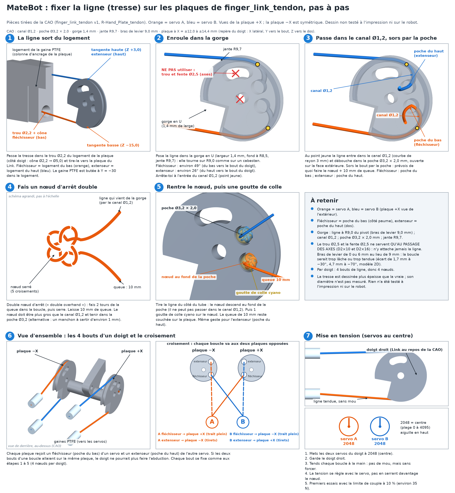

# MateBot – Guide d'assemblage de la main à tendons (v0)

> ⚠️ **Version v0, NON TESTÉE.** Aucune pièce de cette variante n'a encore été imprimée ni mesurée. Les forces sont des **estimations**. Ce guide sera corrigé après le banc d'essai à un doigt.
> Sources : `README.md` et `parts.py` (matebot-hand-tendon), guide officiel *AmazingHand_Assembly.pdf* (Pollen Robotics, CC BY 4.0).

## 0. Principe
- 4 doigts Amazing Hand, 2 DDL par doigt, donc 8 DDL.
- Les servos de la paume sont retirés. **8 × Feetech STS3215 12 V** sont logés dans l'avant-bras, un spool à double gorge (r = 8 mm) sur chacun.
- Chaque servo forme **une boucle antagoniste fermée** : une gorge tire le tendon fléchisseur, l'autre le tendon extenseur.
- Chaque doigt a **deux plaques à tendons** (côté +X et côté −X) sur la pièce `finger_link_tendon`, qui remplace le Link d'origine. Chaque servo a une boucle : fléchisseur sur une plaque, extenseur sur la plaque **opposée** (boucles croisées, sinon le doigt ne peut pas faire d'abduction). Servo A : fléchisseur côté +X, extenseur côté −X. Servo B : fléchisseur côté −X, extenseur côté +X.
- **A et B dans le même sens = flexion. En sens opposé = abduction.**
- Tendons : tresse PE (UHMWPE) classe ~100 lb, dans des gaines PTFE 2 × 4 mm (Bowden).

> 🔄 **v14 (2026-11-12, non testé) :** la plaque v13 est **remplacée** par la même **plaque plate** (`forearm_plate`), avec en plus des trous M3 à l'avant et à l'arrière (4 par bout, poteaux intérieurs, paroi 3 mm) pour des attaches à dessiner plus tard, et une grille M3 pas 15 mm sur les rives (24 trous, vis de l'intérieur vers l'extérieur). 78,0 × 207,56 × 28,0 mm. Servos collés, jeu 0,4 mm, sans colle. Mur arrière fermé, deux trous Ø10 pour les câbles en façade. Vis M2×6 pour l'index et l'annulaire ; pouce et majeur : découpe Ø28. `spool_r8` est inchangé. Dessins : [`forearm_tubes_FR.png`](forearm_tubes_FR.png), [`forearm_chassis_preview.png`](forearm_chassis_preview.png), [`forearm_parts_preview.png`](forearm_parts_preview.png).

## 1. Pièces imprimées (PETG noir sauf mention)
| Pièce | Fichier | Qté (1 main) | Note |
|---|---|---|---|
| Spool double gorge r8 | `spool_r8.stl` | 8 (+2 de rechange) | Cercle de vis officiel 14 mm, 4 × M3×6 (pas plus longues). 100 % de remplissage ou 6 parois, bride sur le plateau |
| Plaque avant-bras (une pièce) | `forearm_plate.stl` | 1 | **Nouveau (v14).** Plaque plate, 78,0 × 207,56 × 28,0 mm, poteaux M3 et grille sur les rives. Face extérieure sur le plateau, murs et poteaux vers le haut, sans support |
| Plaques en U v12 | `forearm_plate_top` / `forearm_plate_bottom` | 0 | **Remplacées (v12).** Ne pas les imprimer pour un montage neuf |
| Demis v11 (poignet / coude) | `forearm_plate_top_wrist` / `_elbow`, `forearm_plate_bottom_wrist` / `_elbow` | 0 | **Remplacés (v11).** Ne pas les imprimer pour un montage neuf |
| Joug / rails / entretoises v10 | `forearm_wrist_yoke`, `forearm_rail_3x_*`, `forearm_brace` | 0 | **Remplacés (v10).** Ne pas les imprimer pour un montage neuf |
| Bloc d'ancrage des gaines (côté servos) | `ptfe_anchor_8x.stl` | 0 (banc seulement) | **Inutile avec la plaque v14** (pas de logements PTFE). Conservé pour le banc |
| Support des servos (banc) | `servo_bay_8x_sts3215.stl` | 1 (banc seulement) | 2 rangées de 4, ≈120 × 103 × 18 mm. Ne rentre pas dans l'avant-bras |
| Bague de pivot d'abduction (remplace la bague achetée Ø int. 6, igus GFM-0608-04) | `bushing_d6_flanged.stl` | Option 1 : 4 (+2 de rechange) ; option 2 : 8 (+2) | Option 1 : seulement la bague du **bas** (celle du haut est remplacée par la bague-rondelle ci-dessous). Option 2 : 2 par doigt. Imprime-les debout (collerette sur le plateau), 0,12 mm, toutes ensemble. Voir le README de `matebot/` |
| **Bague-rondelle** (remplace la grande rondelle M2.5 **et** la bague du haut ; option 1, Gimbal d'origine, vis par le dessus) | `bushing_washer_d6.stl` | 4 (+2 de rechange) | **Nouveau (v8).** Pièce en chapeau : disque Ø10 × 0,9 + manchon Ø ext. 7,95 / Ø int. 6,2 × 3,5, trou de vis Ø2,7. 3 doigts + pouce. Imprime-la disque sur le plateau, manchon vers le haut, sans support, PETG, 0,12 mm, 100 % de remplissage. CAO vérifiée, non testée à l'impression |
| **Rondelle plate imprimée** (remplace la grande rondelle M2.5 ; option 2, `Gimbal_tendon`, vis par en dessous) | `washer_d8_printed.stl` | 3 (+1 de rechange) | **Nouveau (v8).** Rondelle Ø8 × 0,9, trou Ø2,7. À plat sur le plateau. Inutile avec l'option 1 |
| Link à tendons (remplace le Link) | `finger_link_tendon.stl` | 4 (+2 de rechange) | v1 non testé (trous pour les axes ajoutés). Imprime-en 1 d'abord. Supports nécessaires. Voir le README de `matebot/` |
| Gimbal à languette (remplace le Gimbal des 3 doigts de la plaque : index, majeur, annulaire) | `Gimbal_tendon.stl` | 3 (+1 de rechange) | Languette arrière avec fente en arc pour **visser le Gimbal par en dessous**. Imprime-en 1 d'abord, supports en arbre sous la languette. Voir le README de `matebot/` |
| Doigt : Proximal, Distal, Proximal_Shell, Distal_Shell (pas de Link, voir ci-dessus) | `Amazing Hand Parts - <nom>.stl` | 4 de chaque (+2 Distal) | Shells en TPU (le README garde les coques/coussinets TPU d'origine) |
| **Pouce seulement** : Finger_Frame-1 et Gimbal d'origine | `Amazing Hand Parts - Finger_Frame-1.stl`, `Amazing Hand Parts - Gimbal.stl` | 1 de chaque (+1 Gimbal) | Le pouce se monte sur l'interface poignet, pas sur la plaque : il garde son Finger_Frame-1. **Finger_Frame-1 et Finger_Frame-2 ne s'impriment plus** pour index, majeur, annulaire (le bloc de pivot est dans la plaque ; Frame-2 ne servait qu'aux servos) |
| Spacer | `BallJoint_Rod - Spacer.stl` | 0 | **Inutile** avec les tendons (il ne sert qu'aux bielles à rotule d'origine) |
| Plaque de main à gaines (remplace `R-Hand_Plate`) | `R-Hand_Plate_tendon.stl` | 1 | v1 non testé. **Remplace aussi les Finger_Frame-1 et -2** des 3 doigts : bloc de pivot Ø8,15 sous chaque fenêtre + poteau de vissage du Gimbal. 12 logements de gaine (colonnes **1,5 mm plus courtes** : logements 1,5 mm plus proches). Même contour et mêmes trous de vis que l'original. Pas de supports (comme l'original) |
| Coque de paume (remplace `R-Palm_Shell`) | `R-Palm_Shell_tendon.stl` | 1 | Encoches pour les logements, les poteaux et les vis, et **ouverture du pouce agrandie** (1,5 mm de jeu sur toute la course estimée) |
| Coque supérieure, interface poignet | `R-Top_Shell`, `R-Wrist_Interface` | 1 de chaque (main droite) | Inchangées. Le pouce se monte sur l'interface poignet ; ses 4 gaines côté servos ne sont pas sur la plaque v14 (pas de logements ; les tubes passent autour pour l'instant). L'adaptateur RotaWrist (poignet rotatif) reste à concevoir ; le joug tient un poignet fixe |

## 2. Quincaillerie et matériel
- 8 × STS3215 12 V, 1 adaptateur Waveshare Bus Servo Adapter (A) dédié à la main, une alimentation 12 V 10 A.
- Tresse PE ~100 lb, ~7 m de tube PTFE 2 × 4 mm, sertissages ~1 mm (pas encore achetés ni chiffrés).
- Vis **M3×6** : 4 par spool (32), **pas plus longues** (4 mm dans le palonnier de 4,5 mm). Les 8 vis centrales M3×6 sont fournies avec les servos.
- Vis **M2×6** : 4 par servo dans les oreilles du côté fouet (32), **par la face libre** (haut : par en dessous ; bas : par au-dessus). Ne pas utiliser de M2×8 : elles entreraient dans le boîtier.
- Vis **M2×12** (ou M2×10) : 6, à travers la bride du joug (6 mm) dans les trous D2,4 de l'interface poignet.
- Vis **M3×12 + écrous** : 24 (12 recouvrements rail–joug et 12 trous d'entretoises).
- Vis M3 : 4 pour le bloc de banc seulement, 2 par `ptfe_anchor_8x` si tu l'utilises encore au banc.
- Doigts (guide officiel, par doigt) : 2 bagues Ø int. 6 (**imprimées** : `bushing_d6_flanged.stl` ; avec l'option 1 une seule bague, celle du haut est remplacée par `bushing_washer_d6.stl`), **plus de grande rondelle M2.5 à acheter** (elle est imprimée : `bushing_washer_d6.stl` ou `washer_d8_printed.stl`), 2 axes D2×10, 2 axes D2×16, 4 vis thermoplastique 2.5×6, 1 vis 2.5×8 (elle se visse maintenant **par en dessous** dans le poteau de la plaque). Les 3 vis 2.5×8 qui fixaient chaque Finger_Frame à la plaque ne servent plus pour index, majeur, annulaire (le pouce garde les siennes).
- Outils (guide officiel) : forets Ø1.5 et Ø2, taraud M2, tournevis PH0, pince plate, scalpel, Dremel, perceuse.

## 3. Préparer et tester les servos (avant tout montage)
1. **Mesure un STS3215 et son palonnier au pied à coulisse.** Dessin officiel Waveshare ST3215-2D.zip (PDF intitulé SCS215, 8 juin 2022) et STEP ST3215-3D.zip : corps **45,22 × 24,72 mm**, 35 mm jusqu'à la face extérieure du palonnier, cercle de vis **14 mm**, quatre trous M3. Monte le servo par les oreilles du **côté fouet** seulement, avec des M2×6. Compare avec `sts3215.py`. Le jeu `CL = 0,4 mm` est une tolérance d'impression, pas une cote du dessin. Mesure le tien avant d'imprimer toute la série.
2. Branche **un seul servo à la fois** sur l'adaptateur Waveshare, 12 V. Dans le logiciel FD de Feetech, choisis le port COM, règle le débit à **1 000 000**, puis Open et Search.
3. **Change l'ID** de chaque servo. Le README prévoit les **ID 21 à 28** pour la main ; le guide officiel utilise 1 à 8 (index 1-2, majeur 3-4, annulaire 5-6, pouce 7-8). Choisis un des deux schémas et note-le sur chaque servo.
4. **Centrage :** mets chaque servo en position milieu (511 en brut dans la méthode Arduino du guide officiel ; 1 pas ≈ 0,293°). Note la valeur.
5. Vérifie que chaque servo tourne sans bruit et que l'ID répond seul sur le bus.

## 4. Monter la plaque plate (v14, non testé)
- **Disposition retenue :** deux rails de 3 (index, majeur, annulaire ; A au radial, B au cubital) et la paire du pouce au poignet, **faces alternées (TL, TR, BL, BR)** : pouce et majeur en haut, index et annulaire en bas. Les paires restent intactes (A et B au même Y). Le rack est une plaque médiane de 4 mm, ouverte des deux côtés. Longueur du paquet ≈ 241 mm, largeur ≈ 80 mm (joug 88,6 mm), épaisseur ≈ 97 mm (servo+spool) à 110 mm avec les logements. Chaque pièce tient sur un plateau de 250 mm.
- **Disposition v14 :** une rangée de 8, axe long en travers, TL / TR / BL / BR, **servos collés** (jeu 0,4 mm, sans colle). Une seule plaque plate de 4 mm, 78,0 × 207,56 × 28,0 mm, fermée à l'arrière, deux trous Ø10 pour les câbles en façade. 4 × M3 par bout (poteaux intérieurs, paroi 3 mm) pour des attaches futures. Grille M3 pas 15 mm sur les rives (24 trous, vis de l'intérieur vers l'extérieur). Les vis M2×6 (16) fixent l'index et l'annulaire. Pouce et majeur : découpe Ø28. Voir [`forearm_tubes_FR.png`](forearm_tubes_FR.png).
- **Montage :** visse le joug sur `R-Wrist_Interface` avec 6 × M2×12 (poignet fixe, bossage Ø33,6 dans la fenêtre Ø34). Pose chaque servo sur sa face (pouce et majeur **en haut**, index et annulaire **en bas**), câble vers le coude, oreilles du fouet sur la plaque médiane, 4 × M2×6 **par la face libre** (servos du haut par en dessous, servos du bas par au-dessus). Boulonne les rails L et R sur les demi-recouvrements du joug (3 × M3×12 + écrous par rail), puis les 3 entretoises sous la plaque, dans les intervalles entre servos (4 × M3×12 + écrous chacune). Les câbles en guirlande passent dans l'écart central, vers l'adaptateur Waveshare.
- **Banc :** 2 rangées de 4, sorties vers le haut, dans `servo_bay_8x_sts3215`, fixé par 4 × M3. Ce bloc ne rentre pas dans l'avant-bras.

## 5. Spools et enroulement des tendons
1. Fixe le spool sur le palonnier rond d'origine avec **4 × M3×6** (cercle officiel 14 mm). Ne prends pas une vis plus longue : 4 mm dans le palonnier de 4,5 mm, 0,5 mm avant la face intérieure (Waveshare : une vis qui appuie sur le boîtier peut brûler le servo). Le trou central laisse passer la vis centrale M3×6 du palonnier.
2. Servo au **centre**, passe le tendon fléchisseur dans le trou transversal d'une gorge, et l'extenseur dans l'autre.
3. **Enroule au moins 1,5 tour** dans chaque gorge avant l'ancrage, en sens opposés : quand le spool tourne, il tire l'un et relâche l'autre de la même longueur.
4. Repère (estimation CAO) : flexion complète (environ 70° de rotation du Link) ≈ 11 mm de tendon (bras de levier de 9 mm, Link v1), abduction ±20° ≈ ±4,5 mm, jusqu'à 15,5 mm au total ≈ 111° de rotation du spool.

## 6. Gaines PTFE
- 16 gaines (8 boucles × 2), environ 30 à 40 cm chacune.
- Fixe **l'extrémité paume** dans les 12 logements de `R-Hand_Plate_tendon`. Il n'y a pas de logements côté servos sur la plaque v14 (les tubes passent autour pour l'instant). Les 4 gaines du pouce rejoignent le pouce sur l'interface poignet. Mesure ton tube PTFE au pied à coulisse avant d'imprimer (OD supposé 4,0 mm). Colle chaque gaine avec une goutte de colle cyanoacrylate.
- Dans la plaque : chaque côté de doigt a une colonne sous la plaque avec 2 logements, **extenseur en haut, fléchisseur en bas**. Le bout de gaine est à 30 mm derrière le pivot du doigt. Ne croise pas les gaines entre doigts.
- **Rayon de courbure d'au moins 30 mm** partout. Chaque doigt a sa voie **sur sa face** (index : couloir palmaire-radial, majeur : dorsal / fenêtre Ø34, annulaire : couloir palmaire-cubital, pouce : sockets dorsaux puis descente palmaire-radiale) pour que les faisceaux ne se croisent pas en 3D. Voir [`forearm_tubes_FR.png`](forearm_tubes_FR.png) (traits pleins = haut, pointillés = bas). La plaque v14 n'a pas de bride poignet ; le passage dans un poignet rotatif reste à concevoir.
- Repère chaque gaine (doigt, A ou B, fléchisseur ou extenseur) avec du ruban de couleur.

## 7. Assemblage des doigts (d'après le guide officiel)
1. **Reprise des trous Ø2 :** sur Proximal, Distal, Gimbal et `finger_link_tendon` (à la place du Link), les trous de pivot doivent être en partie **glissants** (plusieurs allers-retours de foret) et en partie **serrés** (un seul aller-retour). Nettoie les surfaces imprimées avec support.
2. **Mécanisme :** enfonce les axes D2×10 dans le Distal avec le `finger_link_tendon` entre les oreilles (plaques vers l'extérieur), puis fais de même avec le Gimbal. Les axes passent dans les trous de Ø2,5 des plaques : l'axe D2×10 du Gimbal dans le **trou rond au centre de la plaque** (le pivot du Link), l'axe D2×16 Gimbal ↔ Proximal dans la **fente en arc** au-dessus du pivot (incline un peu le Link, de +10° en extension à −30° en flexion, pour aligner la fente avec l'axe). Enfonce ensuite les axes D2×16 dans le Proximal pour tenir le sous-ensemble ; une fois les axes en place, les trous sont libres. **Vérifie que la flexion et l'extension sont fluides sur toute la course.**
3. **Coques :** Proximal_Shell puis Distal_Shell, avec des vis 2.5×6. **Ne serre pas trop**, sinon la vis traverse la coque mince.
4. **Bagues :** enfonce la première bague imprimée `bushing_d6_flanged` dans le côté **bas** de l'alésage Ø8,15 du bloc de pivot de la plaque (qui remplace le Finger_Frame-1), collerette à l'extérieur, en appuyant sur une surface plane jusqu'à ce que la collerette touche le bloc. C'est le pivot d'abduction. Si une bague est lâche, une goutte de colle cyano sur son corps ; si le pivot du Gimbal ne tourne pas librement, repasse un foret Ø6,2 à la main dans l'alésage et mets une goutte de graisse PTFE ou silicone. Mesure d'abord l'alésage réel de ta plaque imprimée et le pivot réel de ton Gimbal : imprime 2 bagues d'essai avant les 10.
> 🖼️ **Dessins :** `assemblage_doigt_eclate_FR.png` (vue éclatée d'un doigt) et `assemblage_coupes_vis_FR.png` (coupes du chemin de la vis).
>
> **Variante sans réimpression :** le Gimbal d'origine a un trou de Ø1,9 (borgne, ~8,5 mm de profondeur) **sur le dessus** du pivot, côté dos de la main. Tu peux donc utiliser tes Gimbal d'origine (**option 1**) avec la vis 2.5×8 posée **par le dessus** comme dans le guide Pollen, mais **à travers la bague-rondelle imprimée `bushing_washer_d6`** au lieu de la rondelle M2.5 : son disque Ø10 est serré par la vis sur le bout du pivot et tourne avec le Gimbal (le pivot reste libre) ; son manchon se glisse dans l'alésage à la place de la bague du haut. La plaque v6 laisse la place (vérifié en CAO ; la vis 2.5×8 est assez longue : 7,1 mm de filet engagés), mais il faut retirer `R-Top_Shell` pour serrer la vis. Dans ce cas : **une seule bague** `bushing_d6_flanged` (celle du bas, étape 4), saute la bague du haut. Une vis dans l'axe **par en dessous** à travers une bague est impossible : l'axe D2×16 traverse l'axe du pivot et la tête de vis tomberait sur le passage du Link (voir la coupe C).

5. **Montage final (vissage par en dessous) :** présente le doigt par en dessous : le pivot du `Gimbal_tendon` (côté haut) passe dans la première bague, et le **poteau de la plaque passe dans la fente en arc de la languette**. Enfonce la deuxième bague par le haut (collerette dans l'encoche de la dalle). Puis, **par en dessous** (option 2) : rondelle imprimée `washer_d8_printed`, puis **vis thermoplastique 2.5×8 dans le trou Ø1,9 du poteau** (7,1 mm de filet engagés) ; serre jusqu'à ce que la tête touche le poteau (la rondelle reste alors à 0,4 mm de la languette et ne la serre pas). Vérifie à la main que l'abduction (±25°) reste libre. **Pose la coque de paume en dernier**, une fois toutes les vis posées. Pour le **pouce** : Finger_Frame-1 et Gimbal d'origine, vis 2.5×8 sur le dessus du pivot à travers la bague-rondelle `bushing_washer_d6` (à la place de la rondelle), comme l'option 1.

   **Option 1, montage de la bague-rondelle :** bague du bas pressée dans l'alésage ; présente le Gimbal d'origine par en dessous ; pose `bushing_washer_d6` par le haut (manchon vers le bas, dans l'alésage, autour du pivot ; le disque repose sur le bout du pivot) ; visse la 2.5×8 par le trou Ø2,7 jusqu'à serrer le disque sur le pivot. Le Gimbal doit tourner librement en abduction. Si le manchon est trop juste dans l'alésage, ponce-le légèrement.
> 🖼️ **Dessin pas à pas (fixation de la ligne sur les plaques du Link, nœud d'arrêt double, croisement des 4 bouts, mise en tension) :** `noeud_tendon_etapes_FR.png`.
>
> 

6. **Différence avec la version à tendons :** utilise `finger_link_tendon` à la place du Link (mêmes trous de pivot) et saute les bielles à rotule, les palonniers et les Spacers. Chaque plaque a une gorge sur son bord et deux poches pour le nœud ou le sertissage (Ø3,2 × 2 mm, canal de 1,2 mm). **Poche du bas = fléchisseur** (côté paume), **poche du haut = extenseur** (dos du doigt). Passe le tendon dans le canal, fais un **double nœud d'arrêt** (ou sertis) dans la poche, laisse 10 mm de queue, tire la ligne pour ramener le nœud au fond de la poche, puis mets une goutte de colle cyano. **N'attache pas le tendon dans le trou ou la fente de Ø2,5** : leur bras de levier (6 mm ou 0) ne correspond pas aux 9 mm de la gorge, la boucle ne resterait pas fermée. Croise les boucles : fléchisseur du servo A sur la plaque +X et son extenseur sur la plaque −X, l'inverse pour le servo B.
7. Vérifie que les plaques (jusqu'à X = ±14,4 mm) ne touchent ni le doigt voisin ni la fenêtre de la paume sur toute la course. Les extrémités de gaines dans la paume sont déjà dans `R-Hand_Plate_tendon` (12 logements, 30 mm derrière le pivot) ; celles du pouce sont sur la lèvre de la plaque v13 (pas de logements).
8. **Premiers essais avec la limite de couple des servos à 10 %** (environ 35 N dans le tendon) : le Link à tendons est la pièce la plus faible du doigt. Tout ce qui précède est une estimation CAO, non testée.

## 8. Réglage de la tension
> 🖼️ Voir l'étape 7 du dessin `noeud_tendon_etapes_FR.png` (servos A et B à 2048, doigt droit).

1. Mets les deux servos du doigt au **centre** (position **2048**).
2. Tends chaque boucle à la main, doigt droit, puis fais le nœud ou le sertissage.
3. Pas de mou, mais ne force pas : la tension se règle avec le servo, pas en sur-serrant.
4. Après 30 min de cycles, vérifie le fluage de la tresse et retends si besoin.

## 9. Premier test (un doigt, deux servos, gaines de 40 cm)
1. **Limite de couple à 10 %** dans l'EEPROM avant le premier mouvement (30 % au maximum plus tard).
2. Petits mouvements autour du centre :
   - **A+B (même sens) : flexion et extension**
   - **A−B (sens opposés) : abduction**
3. Note la course, le jeu, la friction (lecture de charge du servo) et la température.
4. Ensuite : test au peson (force au bout du doigt), 4 doigts, test de préhension avec une bouteille d'eau, endurance de 30 min. Mets ce guide à jour avec les valeurs mesurées.

## 10. Sécurité
- **Arrêt d'urgence sur la ligne 12 V**, à portée de main.
- Limite de couple basse au départ (10 % pour les essais du doigt) et surveillance de la température. Ne maintiens jamais le servo au couple de blocage.
- Garde les doigts et les cheveux loin des spools pendant les tests. Porte des lunettes, car un tendon peut casser sous tension.
- Un adaptateur de bus séparé pour la main au début, pour faciliter le débogage.

---
*Basé sur l'Amazing Hand de Pollen Robotics (CC BY 4.0). Modifications MateBot : servos sortis de la main, doigts entraînés par tendons Bowden depuis l'avant-bras.*
